University: [ITMO University](https://itmo.ru/ru/)  
Faculty: [FTMI](https://en.itmo.ru/en/faculty/87/Faculty_of_Technological_Management_and_Innovations.htm)  
Course: [Cloud platforms as the basis of technology entrepreneurship](https://ex-itmo-ict-faculty.github.io/cloud-platforms-as-the-basis-of-technology-entrepreneurship/)  
Year: 2026/2027  
Group: U4225  
Author: Половинкин Валерий Валерьевич  
Lab: Lab1  
Date of create: 01.11.2026  
Date of finished: 06.11.2026  

# Лабораторная работа №1 «Обзор Google Cloud и исследование основных сервисов»

## Цель работы

Ознакомиться с основными возможностями и преимуществами облачной платформы Google Cloud.

## Задание

По методичке нужно было:

1. Заполнить Google-форму со своей Gmail-почтой, чтобы получить доступ к Google Cloud.
2. Во вкладке IAM создать service account с ролью `Storage Admin` и именем по шаблону «первая буква имени + фамилия + `-sa-lab1`».
3. Создать минимальную виртуальную машину Compute Engine с типом `e2-micro` в режиме Spot и именем по шаблону «первая буква имени + фамилия + `-vm-lab1`».
4. С помощью утилиты `gcloud` найти бакет `lab1-bucket-itmo`, скопировать 3 файла в локальную папку на VM и показать их командой `ls -lah`.
5. Поменять роль service account с `Storage Admin` на `Compute Viewer`, повторить копирование и сделать выводы.
6. Удалить все созданные ресурсы и написать отчет со скриншотами.

## Ход работы

### 1. Доступ к Google Cloud

Я заполнил форму преподавателя и получил доступ к учебному проекту `cloud-platforms-as-the-basis`. Проект общий для всей группы, поэтому все свои ресурсы я называл с префиксом `vpolovinkin` (по шаблону из методички) и не трогал ресурсы других студентов. На скриншотах списков я ставил фильтр `vpolovinkin`, чтобы в кадр не попадали чужие ресурсы и почты.

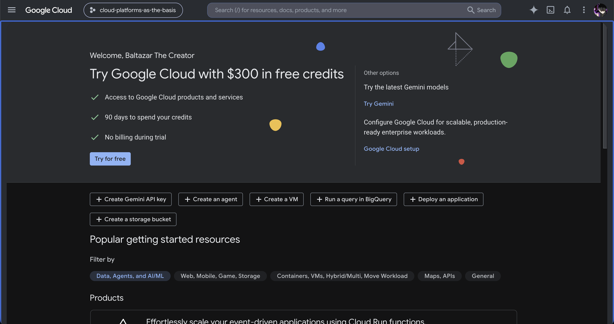

*Рисунок 1. Консоль Google Cloud, выбран учебный проект cloud-platforms-as-the-basis*

### 2. Service account с ролью Storage Admin

**Service account** это учетная запись не для человека, а для программы. В этой работе от его имени виртуальная машина обращается к Cloud Storage.

В разделе **IAM & Admin → Service Accounts** я создал аккаунт:

| Параметр | Значение |
| --- | --- |
| Service account name и ID | `vpolovinkin-sa-lab1` |
| Email | `vpolovinkin-sa-lab1@cloud-platforms-as-the-basis.iam.gserviceaccount.com` |
| Description | Service account for ITMO Cloud Platforms Lab 1 |

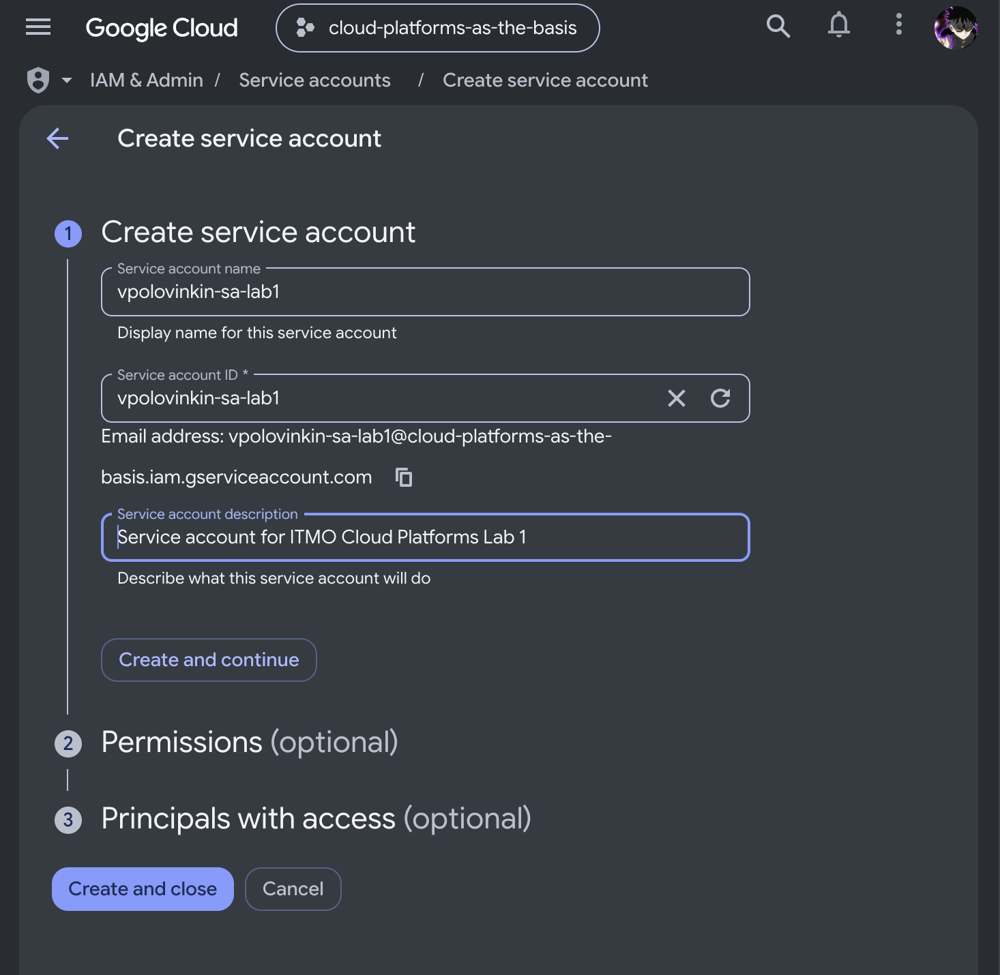

*Рисунок 2. Создание service account*

Роль я выдал на странице **IAM & Admin → IAM** через кнопку **Grant access**: в поле New principals указал адрес аккаунта, в поле Role выбрал **Storage Admin**. Консоль описывает эту роль так: «Grants full control of buckets and objects», то есть полный доступ к бакетам и файлам в них.

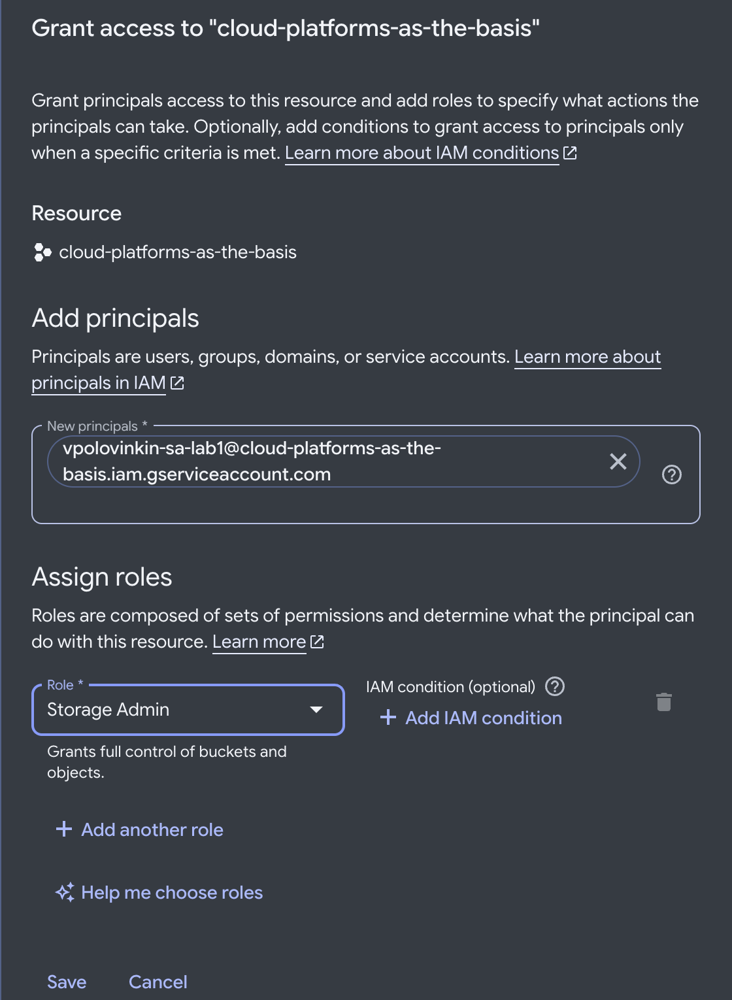

*Рисунок 3. Выдача роли Storage Admin аккаунту vpolovinkin-sa-lab1*

После сохранения в таблице IAM у аккаунта появилась роль Storage Admin.

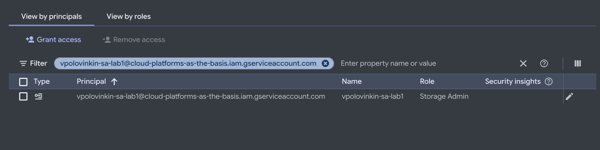

*Рисунок 4. Роль Storage Admin в таблице IAM*

### 3. Виртуальная машина e2-micro в режиме Spot

В разделе **Compute Engine → VM instances → Create instance** я создал машину со следующими настройками:

| Параметр | Значение | Почему так |
| --- | --- | --- |
| Name | `vpolovinkin-vm-lab1` | Шаблон из методички |
| Region / Zone | `europe-north1 (Finland)` / `europe-north1-a` | Регион в Северной Европе вместо региона по умолчанию в США |
| Series / Machine type | E2 / `e2-micro` (0.25-2 vCPU, 1 shared core, 1 GB) | Минимальная машина по заданию |
| VM provisioning model | Spot | Требование методички, дешевле обычной VM |
| On VM termination | Stop (по умолчанию) | При вытеснении машина останавливается, а не удаляется |
| OS and storage | Debian GNU/Linux 13 (trixie), 10 GB balanced persistent disk (по умолчанию) | В образе Debian от Google уже установлена утилита `gcloud` |
| Data protection | No backups | По умолчанию стояло Snapshot schedules. Снимки диска платные, а машина нужна на один раз |
| Observability | Install Ops Agent (по умолчанию) | Не меняли |
| Service account | `vpolovinkin-sa-lab1` | Машина работает от имени нашего аккаунта |
| Access scopes | Allow full access to all Cloud APIs | Так советует документация Google при своем service account: тогда доступ определяют только роли IAM |

**Spot VM** это машина со скидкой на свободных мощностях Google. Платформа может в любой момент остановить ее, если мощности понадобятся. Для короткой учебной задачи это не страшно, а экономия заметная.

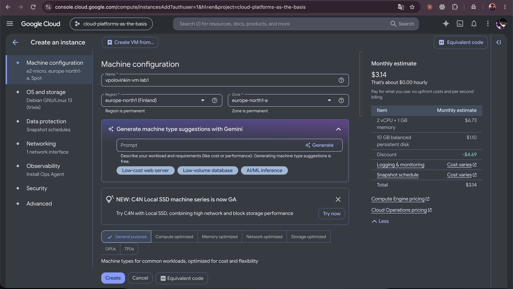

*Рисунок 5. Имя, регион и зона машины, справа оценка стоимости (на этом этапе в Data protection еще стоят Snapshot schedules)*

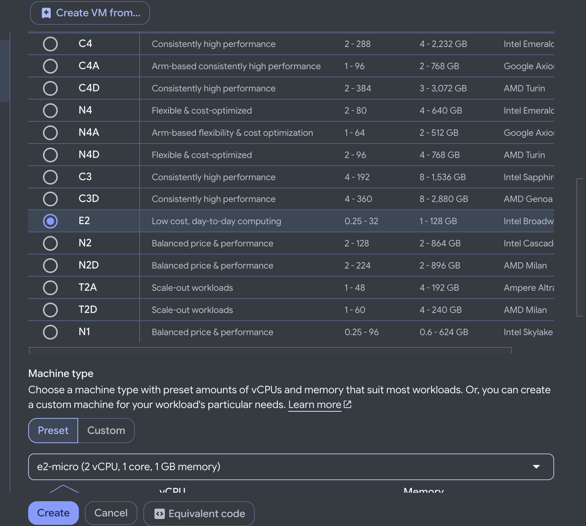

*Рисунок 6. Серия E2 и тип e2-micro*

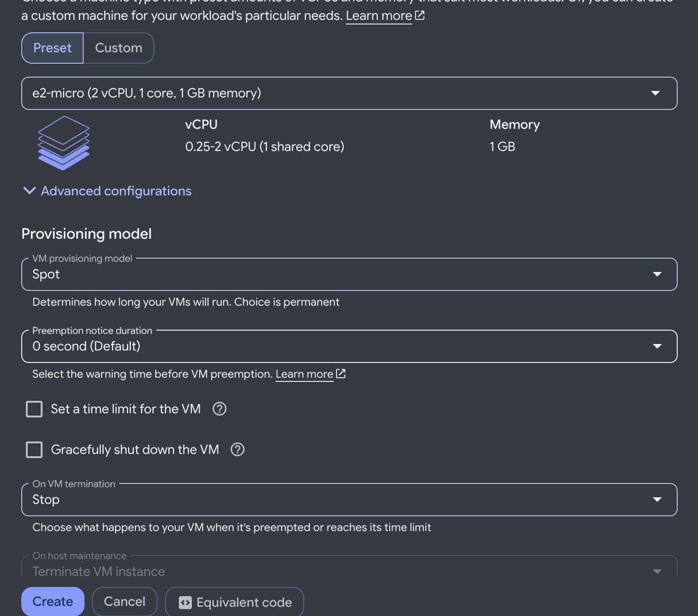

*Рисунок 7. VM provisioning model: Spot*

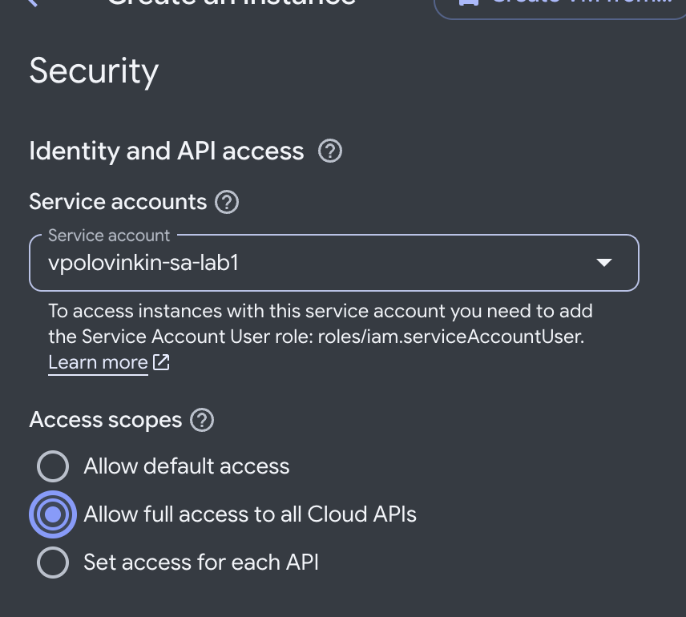

*Рисунок 8. Service account vpolovinkin-sa-lab1 и Allow full access to all Cloud APIs*

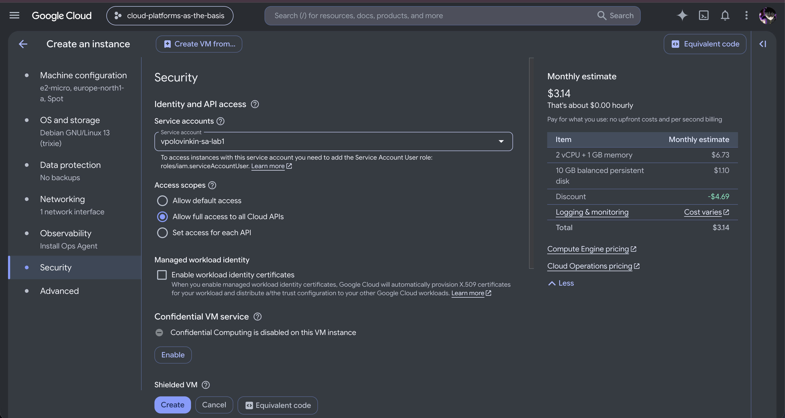

*Рисунок 9. Итог настроек перед созданием (слева Data protection: No backups) и оценка стоимости*

Оценка стоимости из консоли перед созданием машины:

| Статья | В месяц |
| --- | ---: |
| 2 vCPU + 1 GB memory | $6.73 |
| 10 GB balanced persistent disk | $1.10 |
| Discount (скидка Spot) | -$4.69 |
| **Total** | **$3.14** |

Проверка: 6.73 + 1.10 - 4.69 = 3.14. Скидка Spot составила 4.69 / 6.73 ≈ 70% от стоимости процессора и памяти. Консоль пишет «That's about $0.00 hourly». Если поделить месячную сумму на 730 часов, выходит около $0.004 в час (это мой расчет).

После нажатия **Create** машина появилась в списке со статусом «работает» (зеленая галочка), внутренним IP `10.166.0.13` и внешним IP `34.88.122.44`.

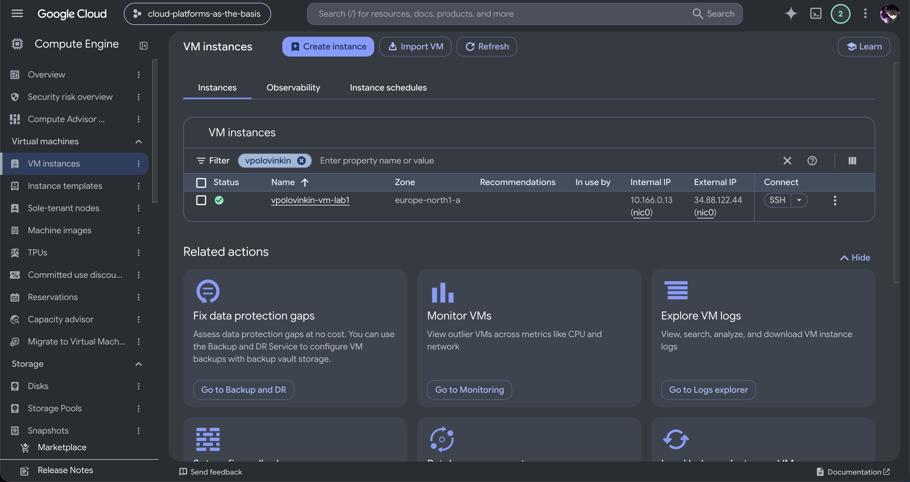

*Рисунок 10. Созданная машина vpolovinkin-vm-lab1*

### 4. Подключение к машине и проверка учетной записи

Я подключился к машине кнопкой **SSH** (SSH-in-browser). Система: Debian GNU/Linux, ядро `6.12.113+deb13-cloud-amd64`.

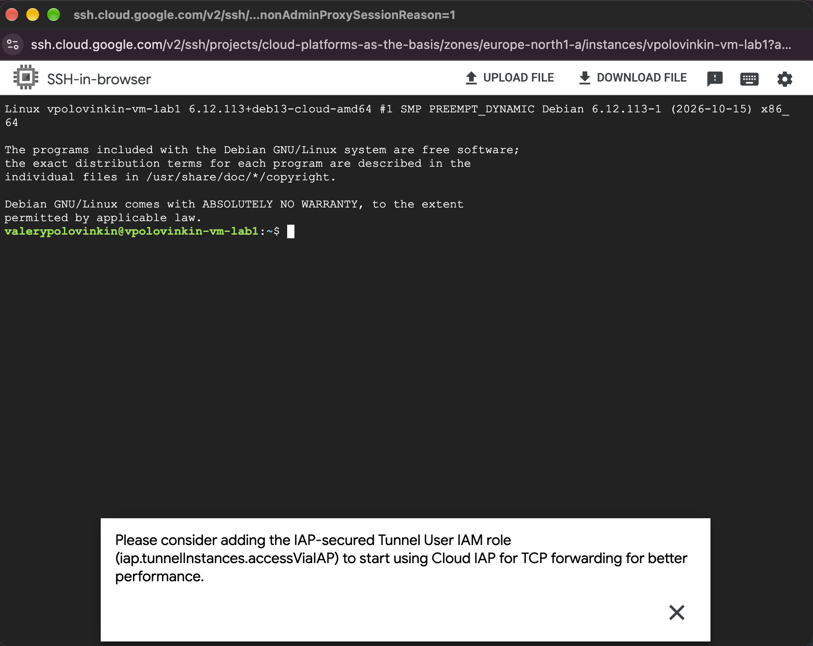

*Рисунок 11. Терминал виртуальной машины в браузере*

Чтобы проверить, от чьего имени `gcloud` работает на машине, выполнил:

```bash
gcloud auth list
```

Активный аккаунт (отмечен звездочкой): `vpolovinkin-sa-lab1@cloud-platforms-as-the-basis.iam.gserviceaccount.com`. Значит, все команды `gcloud` на машине выполняются от имени нашего service account, а не моего личного аккаунта Google.

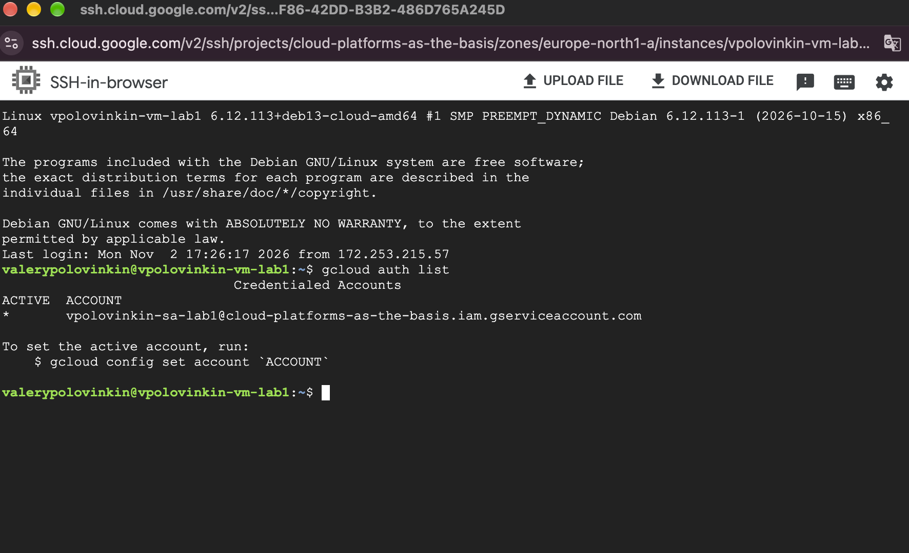

*Рисунок 12. Вывод gcloud auth list*

### 5. Поиск бакета и копирование файлов

Список бакетов проекта:

```bash
gcloud storage ls
```

В проекте нашелся один бакет: `gs://lab1-bucket-itmo/`. Содержимое бакета:

```bash
gcloud storage ls gs://lab1-bucket-itmo
```

Внутри три файла: `pic1.jpg`, `pic2.jpg`, `pic3.jpeg`.

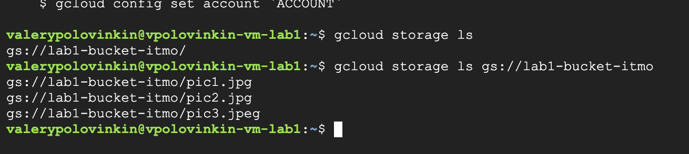

*Рисунок 13. Поиск бакета и список файлов в нем*

Создал папку на машине и скопировал в нее все файлы из бакета. Звездочка взята в кавычки, чтобы ее раскрывал `gcloud` по объектам в бакете, а не командная оболочка по локальным файлам:

```bash
mkdir ~/lab1-files
gcloud storage cp "gs://lab1-bucket-itmo/*" ~/lab1-files/
```

Результат: `Completed files 3/3 | 1.5MiB/1.5MiB`, средняя скорость 2.7 MiB/s.

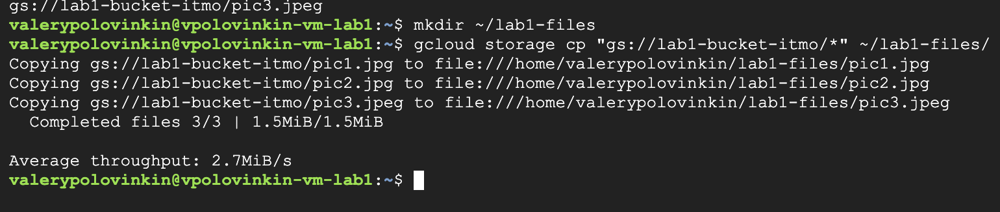

*Рисунок 14. Копирование трех файлов из бакета на машину*

Проверка по методичке:

```bash
ls -lah ~/lab1-files
```

Ключи: `-l` выводит подробный список, `-a` показывает и скрытые элементы (строки `.` и `..` означают текущую и родительскую папки), `-h` пишет размеры в удобных единицах.

| Файл | Размер |
| --- | ---: |
| pic1.jpg | 228K |
| pic2.jpg | 487K |
| pic3.jpeg | 858K |

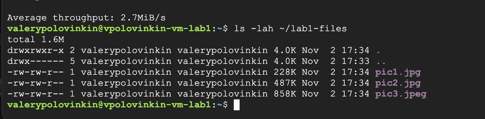

*Рисунок 15. Файлы лежат на виртуальной машине*

### 6. Настройки доступа к самому бакету

Пока у аккаунта еще была роль Storage Admin, я посмотрел политику доступа бакета преподавателя. Эта команда только читает настройки и ничего не меняет:

```bash
gcloud storage buckets get-iam-policy gs://lab1-bucket-itmo
```

| Кто (members) | Роль |
| --- | --- |
| projectEditor, projectOwner | `roles/storage.legacyBucketOwner`, `roles/storage.legacyObjectOwner` |
| projectViewer | `roles/storage.legacyBucketReader`, `roles/storage.legacyObjectReader` |
| **allUsers** | **`roles/storage.objectViewer`** |

Первые строки содержат стандартные записи: участники проекта с базовыми ролями Owner, Editor и Viewer получают соответствующий доступ к бакету. Важна последняя строка. `allUsers` по документации Google означает «anyone who is on the internet, including authenticated and unauthenticated users», то есть любого человека в интернете, с аккаунтом или без. Роль `storage.objectViewer` дает права `storage.objects.get` и `storage.objects.list`, то есть смотреть список файлов и скачивать их. Значит, бакет `lab1-bucket-itmo` публичный на чтение.

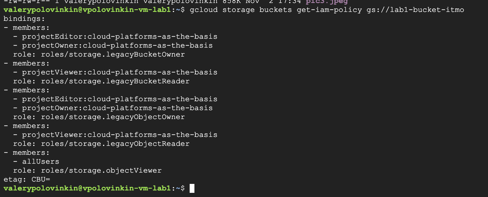

*Рисунок 16. Политика доступа бакета lab1-bucket-itmo*

### 7. Замена роли Storage Admin на Compute Viewer

На странице IAM я открыл редактирование аккаунта (карандаш в его строке) и заменил роль: в блоке Summary of changes видно «Role removed: Storage Admin», «Role added: Compute Viewer». Вторую роль я не добавлял, Storage Admin именно заменена.

Описание Compute Viewer в консоли: доступ только на чтение информации о ресурсах Compute Engine (машины, диски, файрволы), без чтения данных на них. Прав на Cloud Storage в этой роли нет.

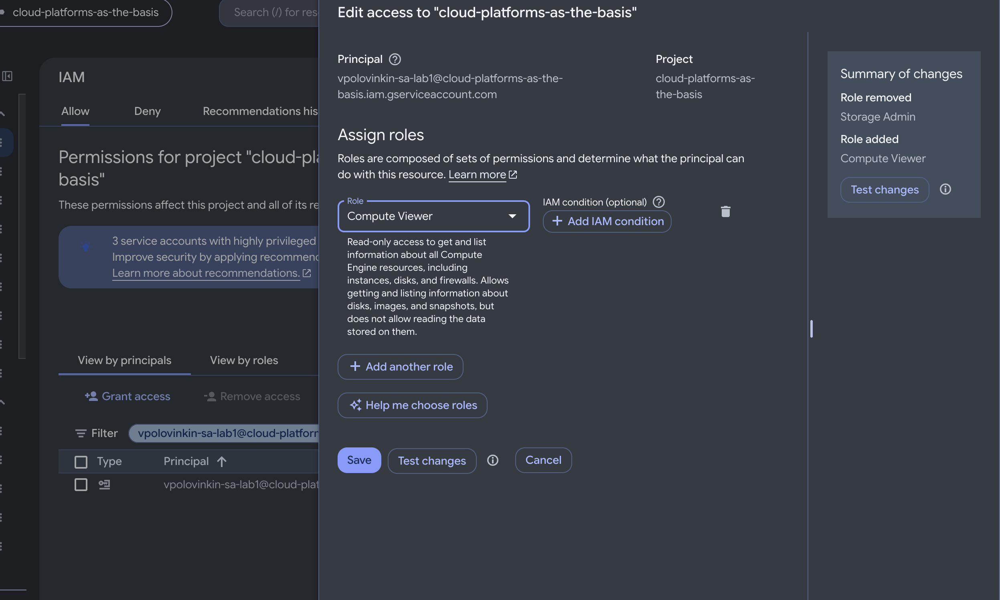

*Рисунок 17. Замена роли на Compute Viewer*

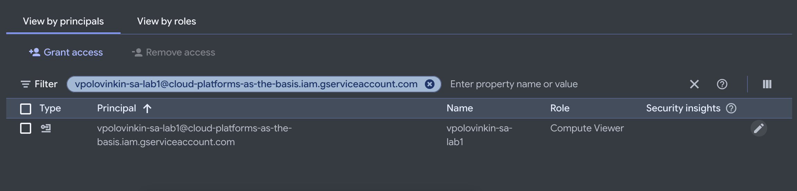

*Рисунок 18. Роль Compute Viewer в таблице IAM*

По документации Google изменение ролей обычно вступает в силу примерно за 2 минуты, иногда за 7 минут и дольше. Поэтому перед проверкой я подождал несколько минут.

### 8. Повтор после смены роли

Список бакетов проекта:

```bash
gcloud storage ls
```

Результат: ошибка `HTTPError 403`. В тексте ошибки сказано, что у `vpolovinkin-sa-lab1` нет права `storage.buckets.list` на проект. Это право было в Storage Admin, а в Compute Viewer его нет. Значит, смена роли сработала.

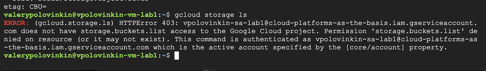

*Рисунок 19. Отказ в доступе к списку бакетов после смены роли*

Затем я повторил шаги с бакетом преподавателя:

```bash
gcloud storage ls gs://lab1-bucket-itmo
mkdir ~/lab1-files-after
gcloud storage cp "gs://lab1-bucket-itmo/*" ~/lab1-files-after/
ls -lah ~/lab1-files-after
```

Список файлов вывелся, копирование прошло успешно: `Completed files 3/3 | 1.5MiB/1.5MiB`, средняя скорость 3.4 MiB/s. В новой папке те же три файла с теми же размерами (228K, 487K, 858K).

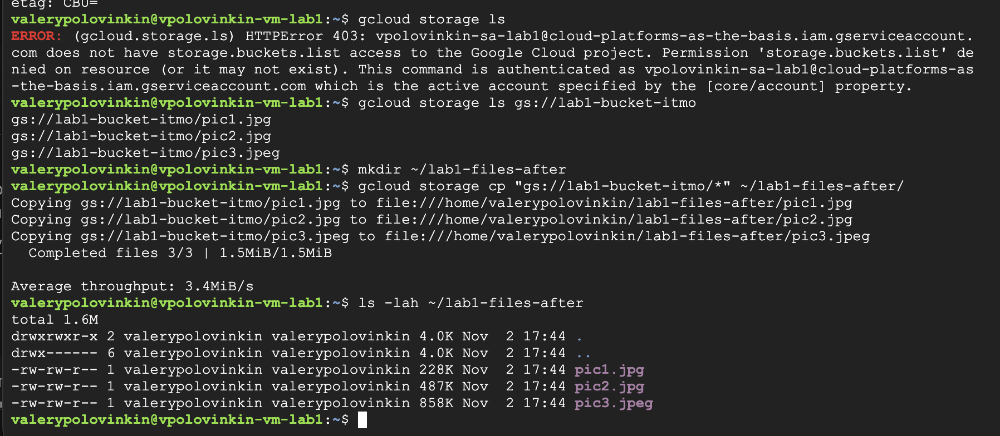

*Рисунок 20. После смены роли: 403 на список бакетов, но файлы публичного бакета по-прежнему копируются*

Сравнение до и после:

| Команда | Роль Storage Admin | Роль Compute Viewer |
| --- | --- | --- |
| `gcloud storage ls` (список бакетов проекта) | `gs://lab1-bucket-itmo/` | Ошибка 403, нет `storage.buckets.list` |
| `gcloud storage ls gs://lab1-bucket-itmo` | 3 файла | 3 файла |
| `gcloud storage cp "gs://lab1-bucket-itmo/*" ...` | 3/3, 1.5 MiB | 3/3, 1.5 MiB |

### 9. Выводы по эксперименту с ролями

1. Роль у аккаунта действительно поменялась. Это видно по ошибке 403: аккаунт больше не может получить список бакетов проекта.
2. Файлы бакета `lab1-bucket-itmo` скачались и после смены роли. Причина в настройках самого бакета: в его политике `allUsers` получает роль `storage.objectViewer`. Это разрешение действует для любого обращения, в том числе для нашего service account, независимо от его роли в проекте.
3. Итоговый доступ складывается из всех разрешений сразу: из ролей на уровне проекта и из политики конкретного ресурса. Убрать у аккаунта роль недостаточно, если ресурс открыт для всех.
4. Чтобы увидеть запрет на скачивание, нужен приватный бакет без `allUsers`. Бакет преподавателя менять нельзя, он общий для группы, поэтому я ограничился анализом его политики доступа.
5. Практический вывод: публичный доступ (`allUsers`) обходит все ограничения по ролям. Его можно давать только тем данным, которые действительно должны быть открыты всем.

### 10. Удаление созданных ресурсов

Методичка требует удалить за собой все созданные сервисы. Я удалил по порядку: машину, ее диск (вместе с машиной), роль аккаунта в IAM и сам аккаунт. В каждом списке я ставил фильтр `vpolovinkin` и отмечал только свою строку.

**Виртуальная машина.** В окне подтверждения сказано, что вместе с машиной удаляется ее загрузочный диск `vpolovinkin-vm-lab1`. Вместе с диском удалились и папки `lab1-files` и `lab1-files-after` (это копии публичных файлов, они не нужны).

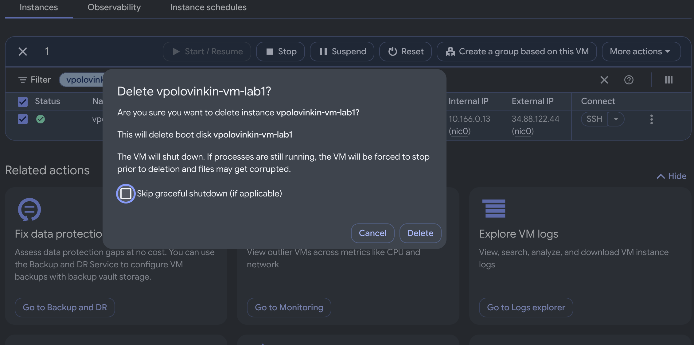

*Рисунок 21. Подтверждение удаления машины и ее диска*

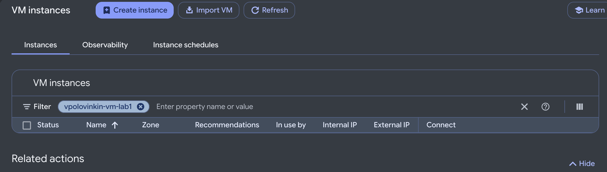

*Рисунок 22. Машины vpolovinkin-vm-lab1 больше нет в списке*

**Диск.** В разделе Compute Engine → Disks по фильтру `vpolovinkin` ничего нет, диск удалился вместе с машиной.

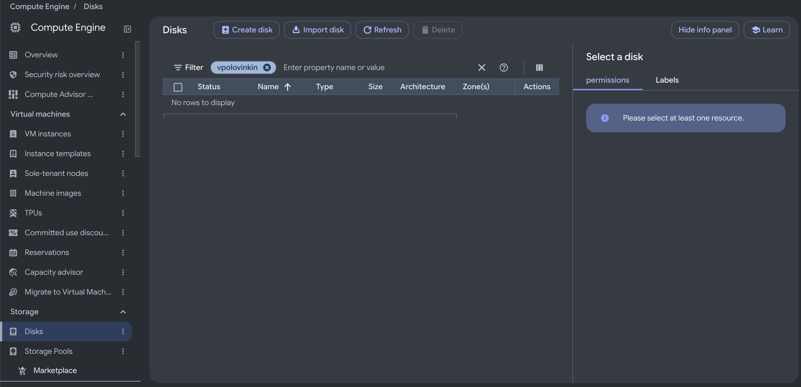

*Рисунок 23. Дисков с именем vpolovinkin нет*

**Роль в IAM.** Ее я убрал до удаления аккаунта. По документации Google, если сначала удалить service account, его записи в политиках не исчезают сразу: они остаются с префиксом `deleted:` и удаляются автоматически в течение 60 дней. Удаление роли через **Remove access**:

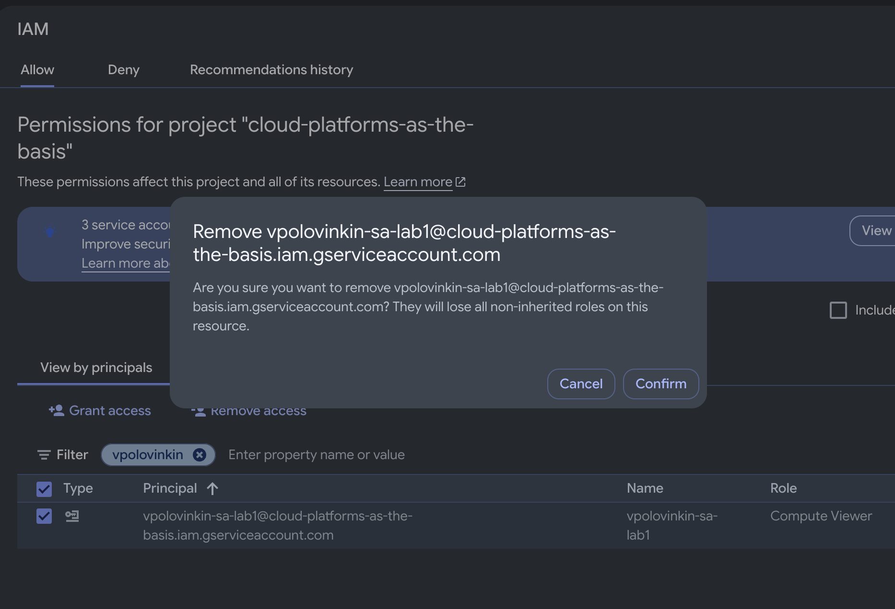

*Рисунок 24. Подтверждение удаления доступа аккаунта в IAM*

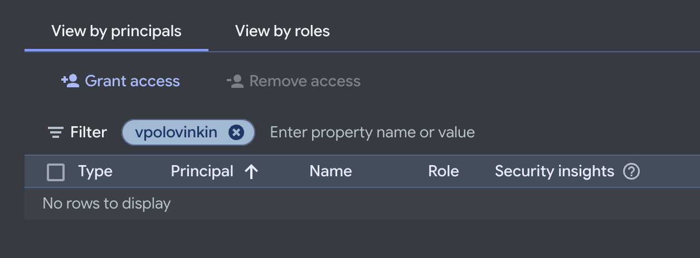

*Рисунок 25. В IAM нет записей vpolovinkin*

**Service account.** Удаление через кнопку **Delete**:

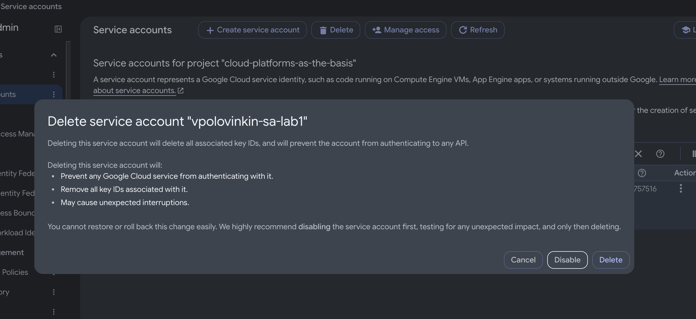

*Рисунок 26. Подтверждение удаления service account*

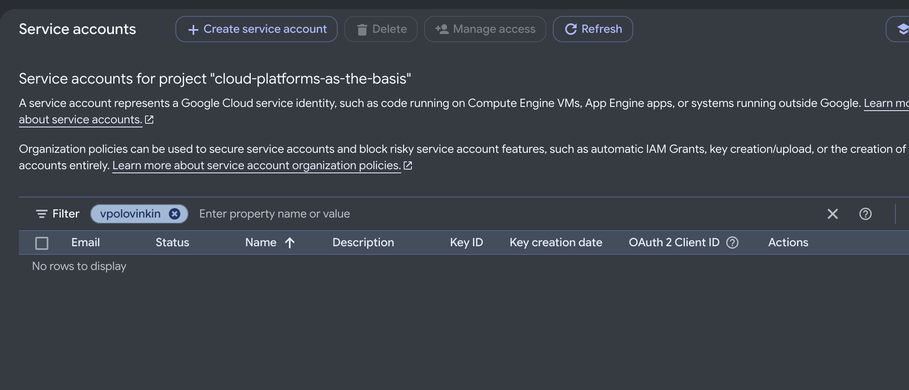

*Рисунок 27. Аккаунта vpolovinkin-sa-lab1 больше нет*

После этого в проекте не осталось ресурсов, созданных в этой работе.

## Результаты

| Пункт методички | Результат |
| --- | --- |
| Доступ к Google Cloud по форме | Выполнено, проект cloud-platforms-as-the-basis |
| Service account с ролью Storage Admin | Выполнено, `vpolovinkin-sa-lab1` |
| VM e2-micro в режиме Spot | Выполнено, `vpolovinkin-vm-lab1`, europe-north1-a, $3.14 в месяц по оценке консоли |
| Найти бакет `lab1-bucket-itmo` через `gcloud` | Выполнено, `gcloud storage ls` |
| Скопировать 3 файла и показать `ls -lah` | Выполнено, 3/3 файла, 1.5 MiB |
| Сменить роль на Compute Viewer, повторить, сделать выводы | Выполнено: 403 на список бакетов, но файлы публичного бакета копируются (причина: `allUsers` в политике бакета) |
| Удалить созданные ресурсы | Выполнено: VM, диск, роль в IAM, service account |
| Отчет со скриншотами | Этот отчет |

## Вывод

В работе я познакомился с основными сервисами Google Cloud на практике: IAM (роли и service account), Compute Engine (Spot VM e2-micro) и Cloud Storage (работа с бакетом через `gcloud`). Машина получила доступ к облаку через прикрепленный service account, без файлов-ключей. Эксперимент со сменой роли показал, что права в Google Cloud складываются из нескольких уровней: роль в проекте отняла у аккаунта доступ к списку бакетов, но публичная политика бакета (`allUsers`) оставила файлы доступными. Spot-машина обошлась бы примерно в $3.14 в месяц вместо $7.83 без скидки, что удобно для коротких и прерываемых задач. После работы все созданные ресурсы удалены, чтобы не оставлять платных ресурсов в общем учебном проекте.

## Источники

1. [Методичка: Лабораторная работа №1](https://ex-itmo-ict-faculty.github.io/cloud-platforms-as-the-basis-of-technology-entrepreneurship/education/labs2023-2024/lab1/lab1/)
2. [Правила оформления отчетов](https://ex-itmo-ict-faculty.github.io/cloud-platforms-as-the-basis-of-technology-entrepreneurship/education/labs2023-2024/reportdesign/)
3. [Google Cloud: Create a VM that uses a user-managed service account](https://docs.cloud.google.com/compute/docs/access/create-enable-service-accounts-for-instances)
4. [Google Cloud: Create and use Spot VMs](https://docs.cloud.google.com/compute/docs/instances/create-use-spot)
5. [Google Cloud: IAM roles for Cloud Storage](https://docs.cloud.google.com/storage/docs/access-control/iam-roles)
6. [Google Cloud: Principals overview (allUsers)](https://docs.cloud.google.com/iam/docs/principals-overview)
7. [Google Cloud: Access change propagation](https://docs.cloud.google.com/iam/docs/access-change-propagation)
8. [Google Cloud: Delete and undelete service accounts](https://docs.cloud.google.com/iam/docs/service-accounts-delete-undelete)
