University: [ITMO University](https://itmo.ru/ru/)  
Faculty: [FTMI](https://en.itmo.ru/en/faculty/87/Faculty_of_Technological_Management_and_Innovations.htm)  
Course: [Cloud platforms as the basis of technology entrepreneurship](https://ex-itmo-ict-faculty.github.io/cloud-platforms-as-the-basis-of-technology-entrepreneurship/)  
Year: 2026/2027  
Group: U4225  
Author: Половинкин Валерий Валерьевич  
Lab: Lab2  
Date of create: 03.11.2026  
Date of finished:  

# Лабораторная работа №2 «Исследование Cloud Run»

## Цель работы

Ознакомиться с работой Cloud Run.

## Задание

По методичке нужно было:

1. Создать Cloud Run из дефолтного сервиса Hello с минимальным количеством ресурсов (или использовать свой сервис).
2. Перейти по ссылке, которую выдает Cloud Run, и протестировать сервис.
3. Перейти в разделы логов и метрик и проанализировать их.
4. Изменить сервис, поменяв порт на 8090, и посмотреть, что произойдет. Попереключать трафик между версиями и сравнить результаты.
5. Удалить все созданные сервисы и написать отчет со скриншотами.

## Что такое Cloud Run

**Cloud Run** запускает готовый контейнер (упакованное приложение) и сам выдает ему HTTPS-адрес. Серверами управлять не нужно: при входящих запросах платформа запускает копии контейнера (экземпляры, instances), а без запросов может уменьшить их число до нуля. При оплате по запросам (request-based) платится время, когда экземпляр запускается, обрабатывает запросы или корректно завершается.

Каждое изменение настроек сервиса создает новую **ревизию**, то есть неизменяемую версию сервиса. Трафик можно направлять на любую ревизию или делить между несколькими в процентах.

## Почему сервис Hello, а не свой

Методичка советует взять свой сервис, если он есть. Мой учебный Telegram-бот с другого курса для этого не подходит: он сам опрашивает серверы Telegram и не принимает HTTP-запросы на порту, а Cloud Run запускает именно веб-сервисы, которые слушают порт. Поэтому я использовал официальный образ Google `us-docker.pkg.dev/cloudrun/container/hello`. Его исходный код открыт ([GoogleCloudPlatform/cloud-run-hello](https://github.com/GoogleCloudPlatform/cloud-run-hello)), и это пригодилось при разборе смены порта.

## Ход работы

### 1. Создание сервиса с минимальными ресурсами

Минимальные значения я брал из документации Cloud Run:

- минимальный CPU равен **0.08 vCPU**;
- минимальная память в первом поколении среды выполнения равна **128 MiB** (второму поколению нужно не меньше 512 MiB);
- CPU меньше 1 разрешен только при трех условиях: максимум **1** одновременный запрос на экземпляр, оплата **по запросам** и **первое поколение** среды выполнения.

В разделе **Cloud Run → Deploy container → Service** я задал:

| Параметр | Значение | Почему так |
| --- | --- | --- |
| Container image URL | `us-docker.pkg.dev/cloudrun/container/hello` | Дефолтный сервис Hello |
| Service name | `vpolovinkin-run-lab2` | Проект общий для группы, поэтому имя с моим префиксом |
| Region | `europe-north1 (Finland)` | Тот же регион, что в лабораторной №1 |
| Authentication | Allow public access | Чтобы ссылка открывалась без входа в Google |
| Billing | Request-based | Оплата только за работу, обязательна при CPU меньше 1 |
| Service scaling | Auto scaling, min 0, max 2 | Без запросов сервис может уйти в ноль. Максимум 2 нужен для деления трафика (см. раздел 6) |
| Ingress | All | Трафик из интернета |
| Container port | 8080 | Значение по умолчанию, позже меняется на 8090 |
| Memory | 128 MiB | Минимум для первого поколения |
| CPU | меньше 1, значение **0.08** | Минимум Cloud Run |
| Maximum concurrent requests per instance | 1 | Обязательное условие для CPU меньше 1 |
| Execution environment | First generation | Обязательное условие для CPU меньше 1 |
| Request timeout | 300 секунд | Значение по умолчанию |

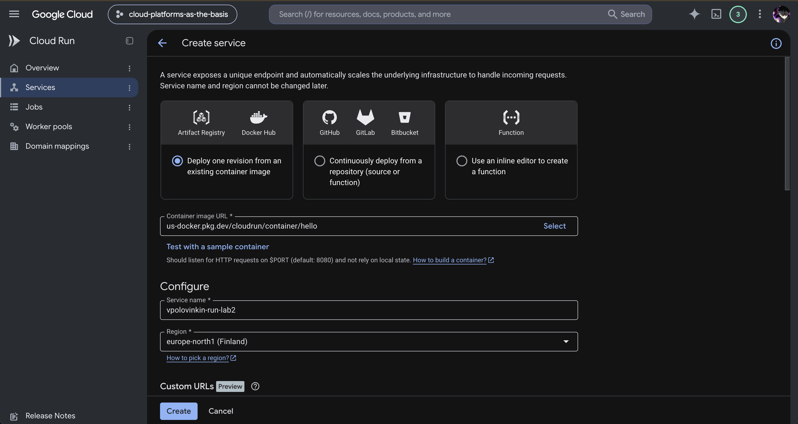

*Рисунок 1. Образ Hello, имя сервиса и регион*

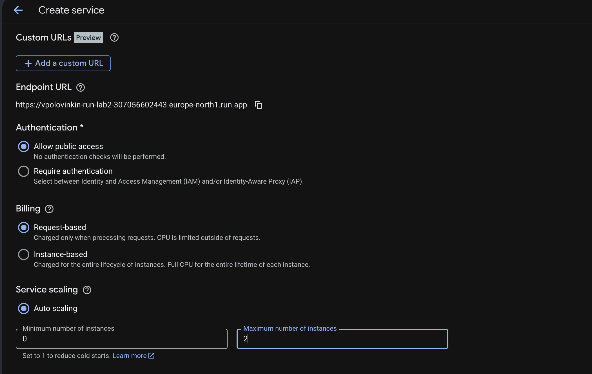

*Рисунок 2. Публичный доступ, оплата по запросам, масштабирование от 0 до 2*

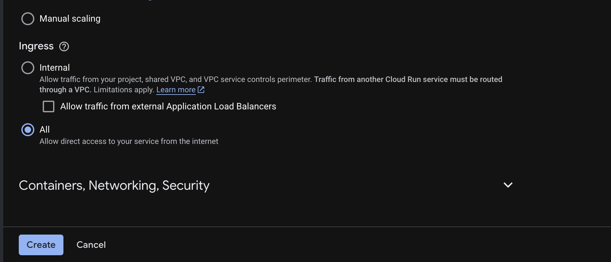

*Рисунок 3. Ingress: All*

Сначала в списке CPU было доступно только значение 1. Дробный вариант («< 1», значение 0.08) появился только после того, как я поставил максимум 1 одновременный запрос и первое поколение среды выполнения. Это совпадает с требованиями из документации. На рисунке 4 также видна подсказка консоли: временный диск (Ephemeral disk) поддерживается только во втором поколении.

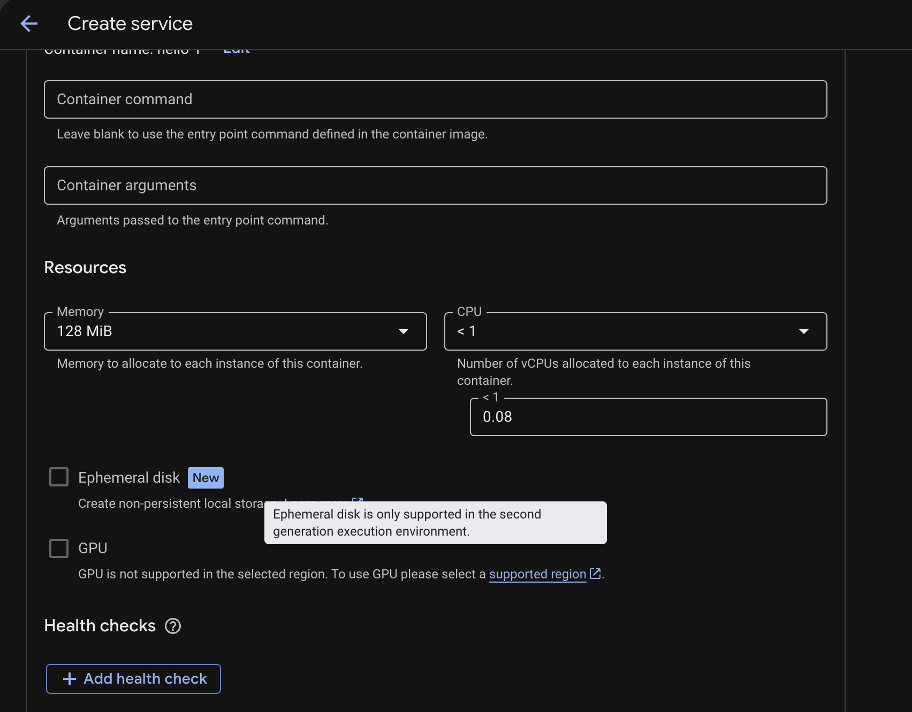

*Рисунок 4. Память 128 MiB, CPU 0.08*

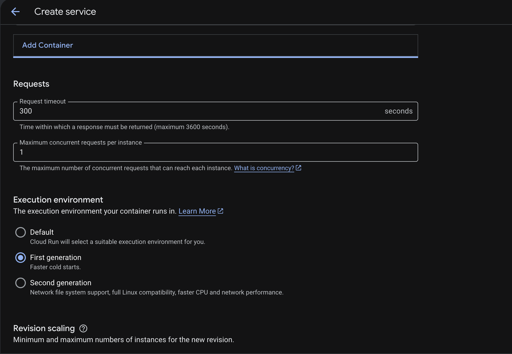

*Рисунок 5. Один одновременный запрос и первое поколение среды выполнения*

После нажатия **Create** сервис запустился. На странице сервиса видно:

- адрес `https://vpolovinkin-run-lab2-307056602443.europe-north1.run.app`;
- первую ревизию `vpolovinkin-run-lab2-00001-9pg` со **100%** трафика;
- настройки ревизии: Billing Request-based, Concurrency 1, Execution environment First generation, Port 8080, **CPU limit 80 millis** (это и есть 0.08 vCPU), Memory limit 128MiB;
- Startup CPU boost: Enabled. Эту настройку я не менял. Она временно дает контейнеру больше CPU на время запуска.

Строку с моей почтой (кто развернул ревизию) на скриншотах я закрыл, так как репозиторий публичный.

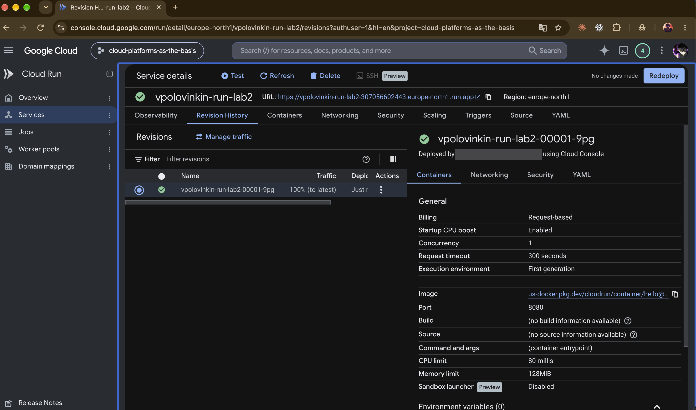

*Рисунок 6. Сервис создан, первая ревизия получает 100% трафика*

### 2. Проверка сервиса по ссылке

По адресу сервиса открылась страница **«It's running!»**. На ней Hello показывает, какая ревизия ответила: `vpolovinkin-run-lab2-00001-9pg` сервиса `vpolovinkin-run-lab2` в регионе `europe-north1` в проекте `cloud-platforms-as-the-basis`. Это удобно для проверки переключения трафика: по странице сразу видно, какая версия обработала запрос.

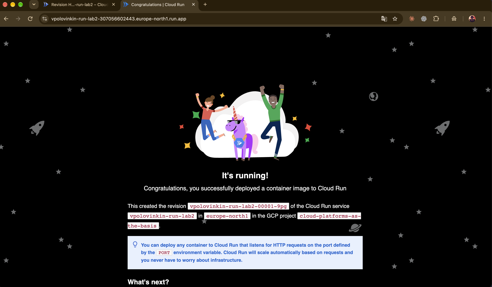

*Рисунок 7. Страница сервиса Hello, ответила ревизия 00001-9pg*

Затем я несколько раз обновил страницу, чтобы в логах и метриках появились запросы.

### 3. Анализ логов

Логи смотрел на вкладке **Observability → Logs**. Время в консоли указано по Москве (MSK).

**Запуск сервиса (19:32):**

| Время | Запись | Что означает |
| --- | --- | --- |
| 19:32:52.193 | CreateService | Создание сервиса (запись аудита) |
| 19:32:55.457 | Starting new instance. Reason: DEPLOYMENT_ROLLOUT | Запуск экземпляра из-за развертывания новой ревизии |
| 19:32:55.872 | 2026/11/03 16:32:55 Hello from Cloud Run! The container started successfully and is listening for HTTP... | Сообщение самого контейнера. Контейнер пишет время в UTC, поэтому 16:32 вместо 19:32 |
| 19:32:55.873 | Default STARTUP TCP probe succeeded after 1 attempt for container "hello-1" on port 8080 | Cloud Run проверил, что контейнер слушает порт 8080 |
| 19:32:55.970 и 19:32:57.297 | Ready condition status changed to True | Ревизия и сервис готовы принимать запросы |

**Запросы (19:34):**

| Время | Запись | Размер | Время ответа |
| --- | --- | ---: | ---: |
| 19:34:00.756 | GET 200 | 4.96 KiB | 285 ms |
| 19:34:01.268 | GET 200 | 6.25 KiB | 274 ms |
| 19:34:01.269 | GET 200 | 1.79 KiB | 231 ms |
| 19:34:01.269 | GET 200 | 42.25 KiB | 99 ms |
| 19:34:01.286 | Starting new instance. Reason: AUTOSCALING | | |
| 19:34:01.613 и 19:34:01.619 | Второй экземпляр: «Hello from Cloud Run!» и STARTUP TCP probe on port 8080 | | |
| 19:34:30.913 | GET 200 | 4.96 KiB | 27 ms |
| 19:34:32.474 | GET 200 | 4.96 KiB | 2 ms |
| 19:34:33.724 | GET 200 | 4.96 KiB | 2 ms |
| 19:34:34.945 | GET 200 | 4.96 KiB | 2 ms |
| 19:34:36.060 | GET 200 | 4.96 KiB | 77 ms |

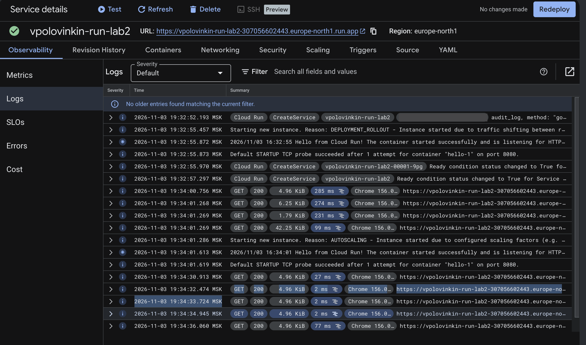

*Рисунок 8. Логи запуска сервиса и запросов*

Выводы по логам:

1. **Все запросы успешные**, код 200, ошибок нет.
2. **Холодный и теплый старт.** Первые запросы обрабатывались 231-285 мс, а после того как контейнер был запущен, страница отдавалась за 2 мс.
3. **Автомасштабирование из-за concurrency 1.** При первом открытии браузер почти одновременно запросил страницу и ее файлы: по размерам видно, что запросы разные, а все следующие обновления страницы имеют тот же размер 4.96 KiB. Один экземпляр с ограничением в 1 запрос не может обработать их параллельно, поэтому Cloud Run сразу запустил второй экземпляр (Reason: AUTOSCALING). Больше двух экземпляров не появилось, потому что максимум задан равным 2.
4. **Порт.** Cloud Run считает контейнер готовым только после успешной проверки порта (STARTUP TCP probe on port 8080).

### 4. Анализ метрик

Метрики смотрел на вкладке **Observability → Metrics** за последний час. Значения ниже я снимал с графиков на глаз, поэтому они приблизительные.

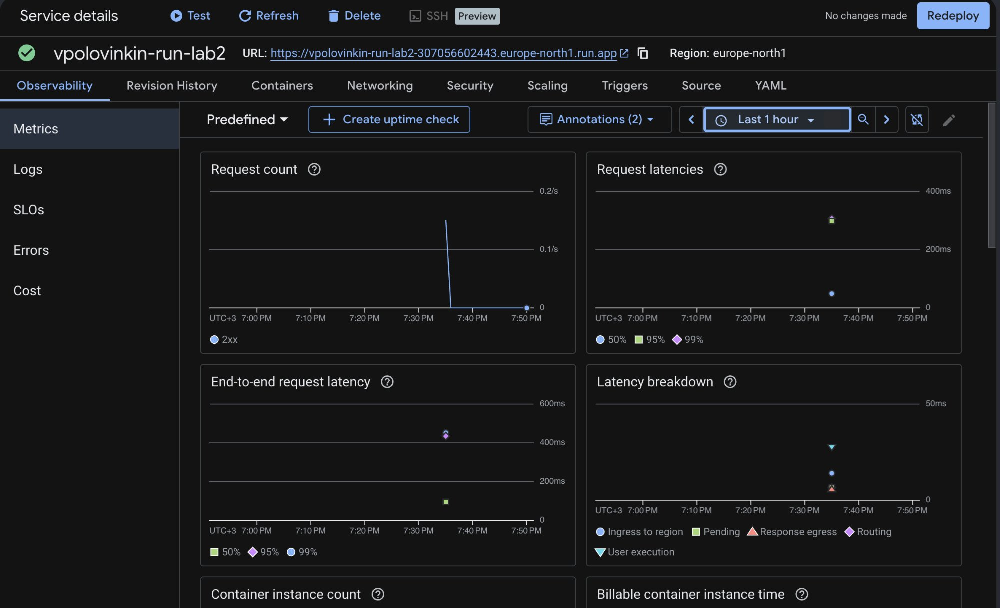

*Рисунок 9. Количество запросов и задержки*

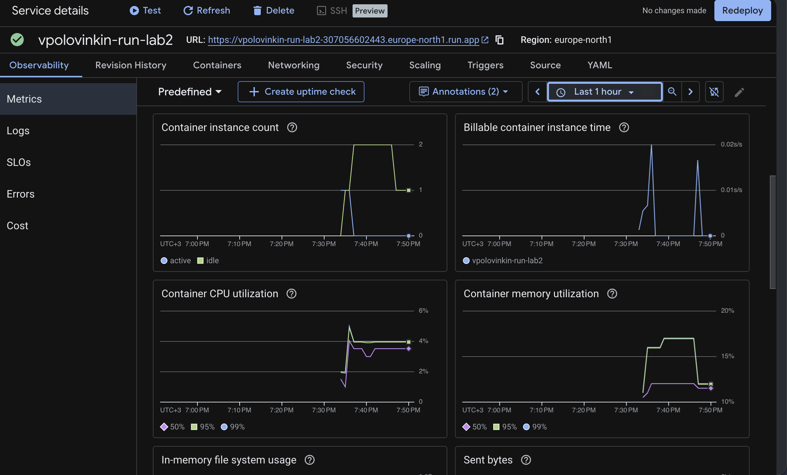

*Рисунок 10. Экземпляры, оплачиваемое время, CPU и память*

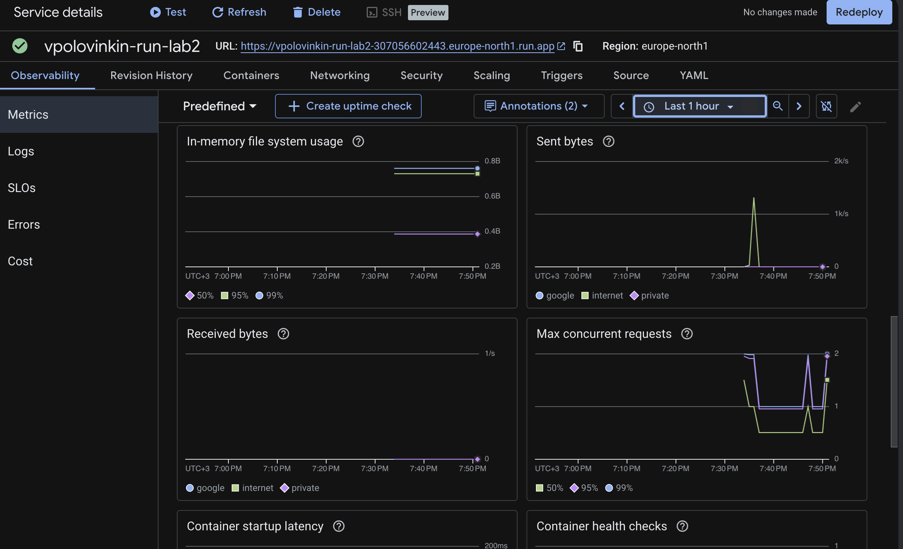

*Рисунок 11. Файловая система в памяти, сетевой трафик, одновременные запросы*

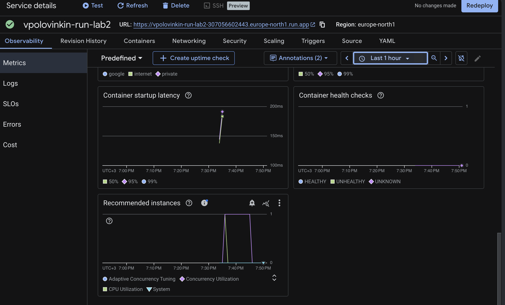

*Рисунок 12. Время запуска контейнера, проверки здоровья, рекомендуемое число экземпляров*

| Метрика | Что видно на графике |
| --- | --- |
| Request count | Только ответы 2xx (успешные), короткий всплеск около 0.15 запроса в секунду, затем 0 |
| Request latencies | 50-й процентиль около 50 мс, 95-й и 99-й около 300 мс |
| End-to-end request latency | 50-й процентиль около 95 мс, 95-й и 99-й около 440 мс |
| Latency breakdown | Больше всего времени занимает выполнение в контейнере (User execution, около 27 мс), вход в регион около 14 мс |
| Container instance count | Активный (active) экземпляр был только во время запросов. Около 10 минут два экземпляра оставались запущенными без работы (idle), затем остался один |
| Billable container instance time | Два коротких всплеска: во время запросов и около 19:47 |
| Container CPU utilization | Около 3.5-4%, максимум около 5% от 0.08 vCPU |
| Container memory utilization | 50-й процентиль около 12%, 95-й и 99-й до 17% от 128 MiB, то есть примерно 15-22 MiB |
| In-memory file system usage | Меньше 1 байта, контейнер ничего не записывает |
| Sent bytes / Received bytes | Отправка до примерно 1.3 KB/s во время запросов, прием почти 0 |
| Max concurrent requests | Значения до 2 |
| Container startup latency | Около 150-190 мс |
| Container health checks | 0, проверки здоровья я не настраивал |
| Recommended instances | 1 в период запросов |

Выводы по метрикам:

1. **Ресурсов хватает с запасом.** Даже на минимальных 0.08 vCPU и 128 MiB сервис Hello использует около 4% CPU и не больше 17% памяти.
2. **Задержки зависят от холодного старта.** Высокие 95-й и 99-й процентили (300-440 мс) дают первые запросы после запуска контейнера, обычный ответ намного быстрее.
3. **Экземпляры не исчезают сразу.** После запросов экземпляры еще какое-то время остаются запущенными в состоянии idle. По странице тарифов Cloud Run при оплате по запросам платными считаются запуск экземпляра, обработка запросов и корректное завершение, а простаивающие экземпляры сверх минимального числа не оплачиваются. Второй всплеск оплачиваемого времени около 19:47 по времени совпадает с тем, когда второй экземпляр пропал с графика, поэтому, скорее всего, это и есть его завершение. Точно проверить это по графикам я не могу.
4. **Max concurrent requests.** Официального описания, как Cloud Run считает этот график, я не нашел, поэтому выводов по нему не делаю.

**Оценка стоимости минимальной конфигурации.** По базовым ценам со страницы тарифов Cloud Run (столбец Default, оплата по запросам): CPU $0.000024 за vCPU-секунду, память $0.0000025 за GiB-секунду, $0.40 за миллион запросов. Регион europe-north1 по странице локаций относится к Tier 1.

| Конфигурация | CPU, $ в секунду | Память, $ в секунду | Итого, $ в секунду | За час работы |
| --- | ---: | ---: | ---: | ---: |
| 0.08 vCPU, 128 MiB (наша) | 0.08 × 0.000024 = 0.00000192 | 0.125 × 0.0000025 = 0.0000003125 | 0.0000022325 | около $0.008 |
| 1 vCPU, 512 MiB (для сравнения) | 0.000024 | 0.5 × 0.0000025 = 0.00000125 | 0.00002525 | около $0.091 |

Минимальная конфигурация примерно в 11 раз дешевле за секунду работы (0.00002525 / 0.0000022325 ≈ 11.3). Кроме того, по странице тарифов действует бесплатный лимит: 180 000 vCPU-секунд, 360 000 GiB-секунд и 2 млн запросов в месяц, причем он считается на весь платежный аккаунт, а не на один проект. Наш тест занял секунды работы контейнера, поэтому расход здесь измеряется долями цента. Реальный счет учебного проекта мне не виден, так как доступа к биллингу у меня нет.

### 5. Смена порта на 8090

На вкладке **Containers** я изменил **Container port** с 8080 на 8090. Под полем консоль сама предупреждает: «We recommend listening on $PORT instead of this specific number».

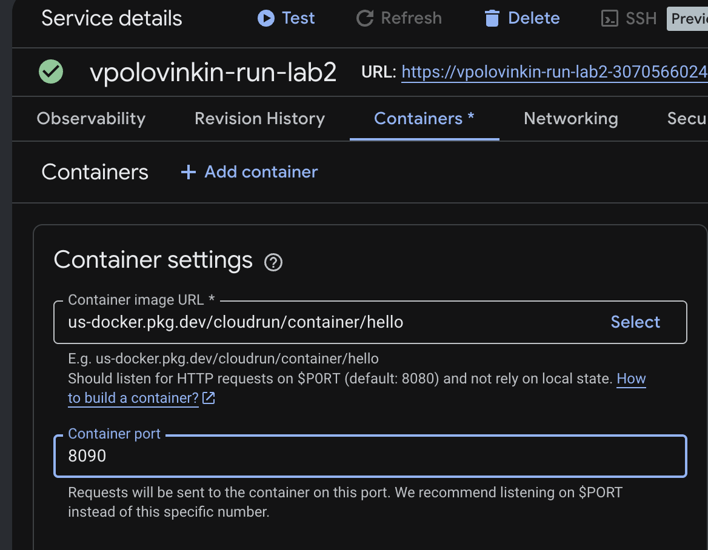

*Рисунок 13. Новый порт 8090*

Перед развертыванием консоль показала сравнение: Port, Current **8080**, New **8090**. Галочка **Serve this revision immediately** означает, что новая ревизия сразу получит 100% трафика.

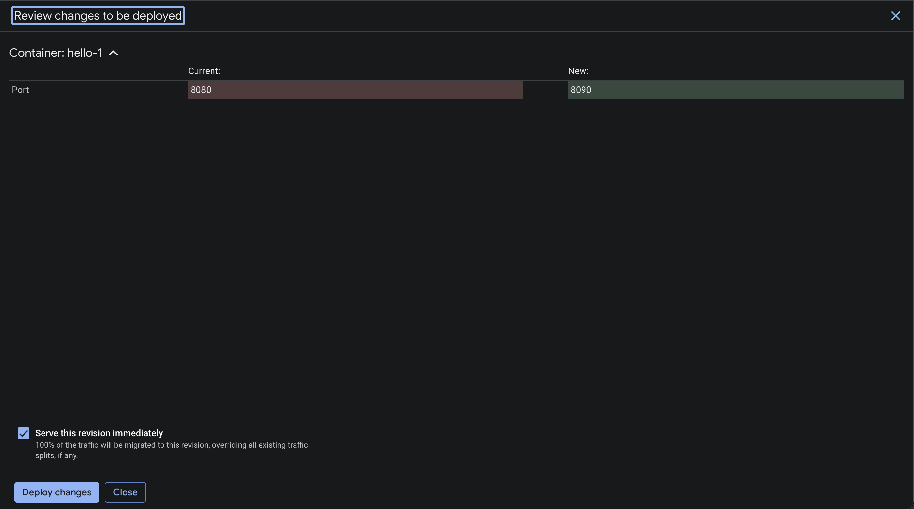

*Рисунок 14. Сравнение старой и новой конфигурации*

После **Deploy changes** все три этапа (Updating service, Creating revision, Routing traffic) завершились успешно. Появилась вторая ревизия **`vpolovinkin-run-lab2-00002-7dd`** со 100% трафика, у первой `00001-9pg` осталось 0%. Старая ревизия не удалилась, она просто не получает трафик.

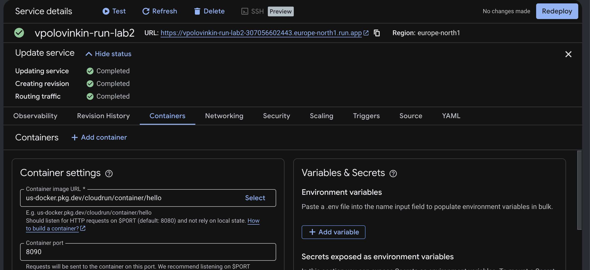

*Рисунок 15. Обновление сервиса завершено*

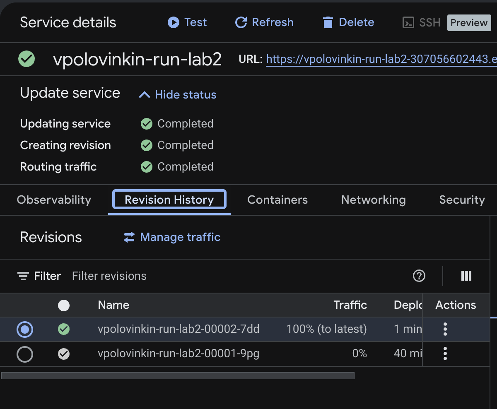

*Рисунок 16. Две ревизии: 00002-7dd получает 100%, 00001-9pg 0%*

Сервис продолжил работать по тому же адресу, страница Hello показывает новую ревизию `00002-7dd`.

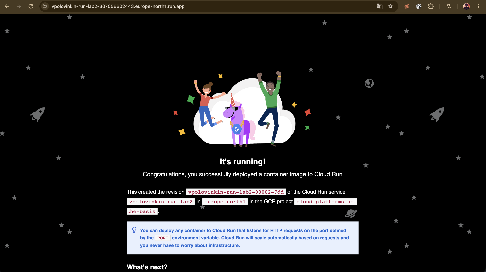

*Рисунок 17. После смены порта отвечает ревизия 00002-7dd*

В логах новой ревизии (20:11:57 по Москве):

- `Starting new instance. Reason: DEPLOYMENT_ROLLOUT`;
- сообщение контейнера: `2026/11/03 17:11:57 Hello from Cloud Run! The container started successfully and is listening for HTTP requests on port 8090`;
- `Default STARTUP TCP probe succeeded after 1 attempt for container "hello-1" on port 8090`;
- ревизия `00002-7dd` перешла в состояние Ready.

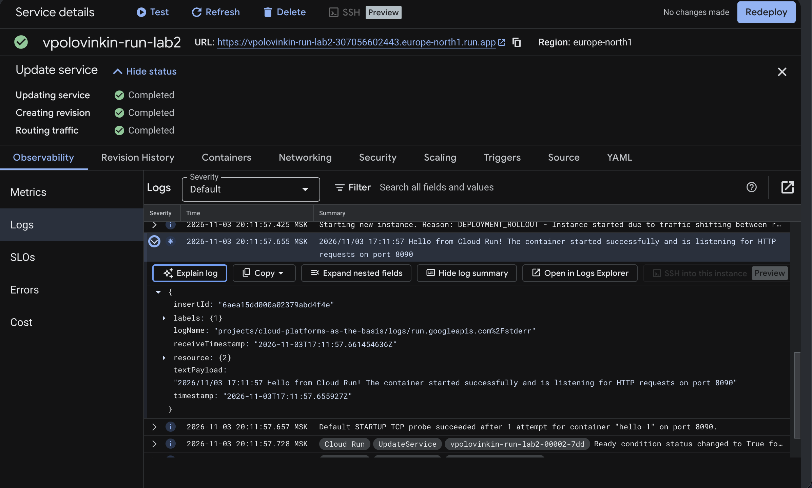

*Рисунок 18. Логи новой ревизии: контейнер слушает порт 8090*

**Что произошло и почему.** Сервис не сломался. Cloud Run передает контейнеру номер порта в переменной окружения `PORT`, а Hello берет порт именно из нее. В исходном коде Hello это выглядит так:

```go
port := os.Getenv("PORT")
if port == "" {
	port = "8080"
}
```

Поэтому после смены настройки контейнер сам стал слушать 8090, и проверка запуска на порту 8090 прошла с первой попытки. Если бы в приложении порт 8080 был прописан жестко, проверка на 8090 не прошла бы и новая ревизия не стала бы готовой. Это мой вывод из исходного кода и логов, такой сценарий я отдельно не проверял. Внешний адрес сервиса при смене порта не меняется: снаружи сервис всегда доступен по HTTPS, а порт контейнера является внутренней настройкой.

### 6. Переключение трафика между версиями

В панели **Revision History → Manage traffic** есть три режима:

- **Send all traffic to the latest revision**: весь трафик на последнюю ревизию, каждая новая версия сразу получает трафик;
- **Send all traffic to one revision**: весь трафик на одну выбранную ревизию;
- **Split traffic across multiple revisions**: деление трафика между ревизиями в процентах.

**Деление 50/50.** Я выбрал Split traffic и поставил 50% на `00002-7dd` и 50% на `00001-9pg`. Ошибки не было: по документации максимальное число экземпляров сервиса распределяется между ревизиями пропорционально долям трафика, а у нас максимум 2, то есть по одному экземпляру на каждую ревизию. Поэтому максимум 2 я поставил заранее, еще при создании сервиса.

В статусе после сохранения было только Updating service и Routing traffic, без Creating revision: перераспределение трафика не создает новую ревизию, а меняет только маршрутизацию.

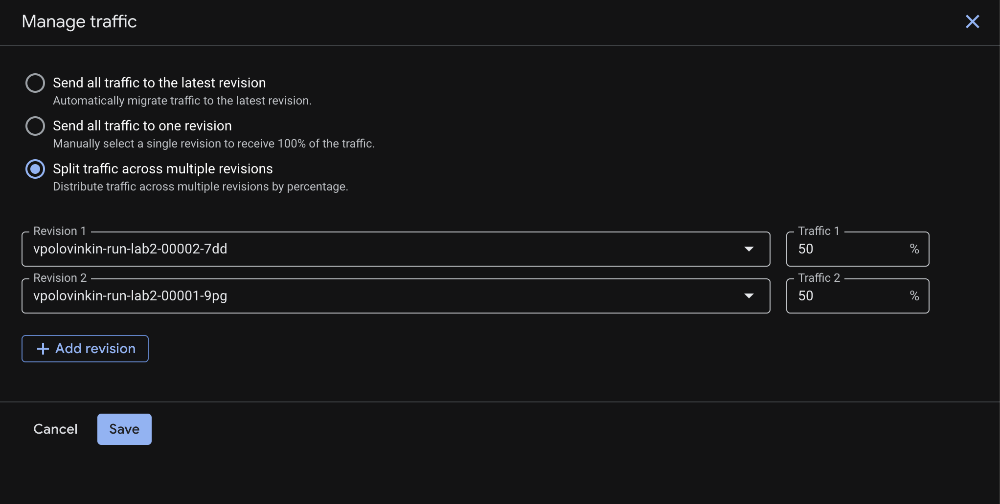

*Рисунок 19. Настройка деления трафика 50/50*

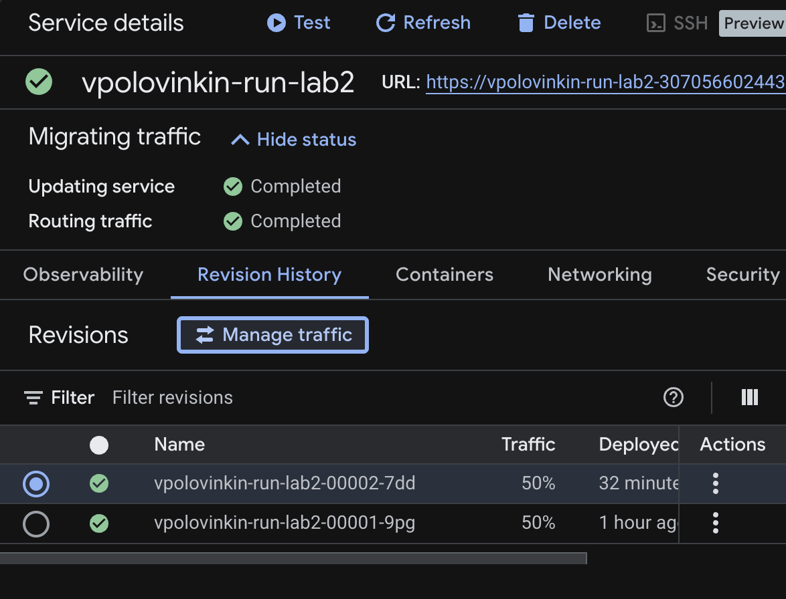

*Рисунок 20. Обе ревизии получают по 50%*

Чтобы сравнить, как трафик распределяется на самом деле, я отправил с компьютера 20 запросов подряд и посчитал, какая ревизия ответила на каждый. Этого шага нет в методичке, я добавил его, чтобы получить измеримый результат вместо обновления страницы в браузере:

```bash
for i in $(seq 1 20); do curl -s https://vpolovinkin-run-lab2-307056602443.europe-north1.run.app | grep -o 'vpolovinkin-run-lab2-0000[0-9]-[a-z0-9]*' | head -1; done | sort | uniq -c
```

`curl` скачивает страницу сервиса, `grep` вырезает из нее имя ответившей ревизии, цикл повторяет это 20 раз, а `sort | uniq -c` считает ответы каждой ревизии. Результат: **10 ответов от `00001-9pg` и 10 от `00002-7dd`**. Ровное деление здесь отчасти совпадение: 50% задает вероятность для каждого запроса, а не строгое чередование, поэтому на 20 запросах результат вроде 9 и 11 тоже был бы нормальным.

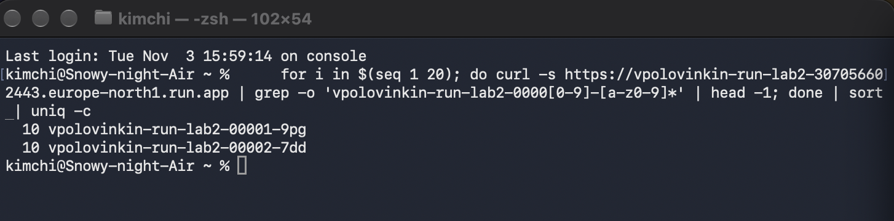

*Рисунок 21. 20 запросов при делении 50/50*

**Откат на старую версию.** Режим Send all traffic to one revision, ревизия `00001-9pg`: она получила 100%, новая 0%. Та же команда показала **20 ответов из 20 от `00001-9pg`**. Откат занял секунды, ничего не пересобиралось и не удалялось. Так в реальной работе возвращают предыдущую версию, если с новой что-то не так.

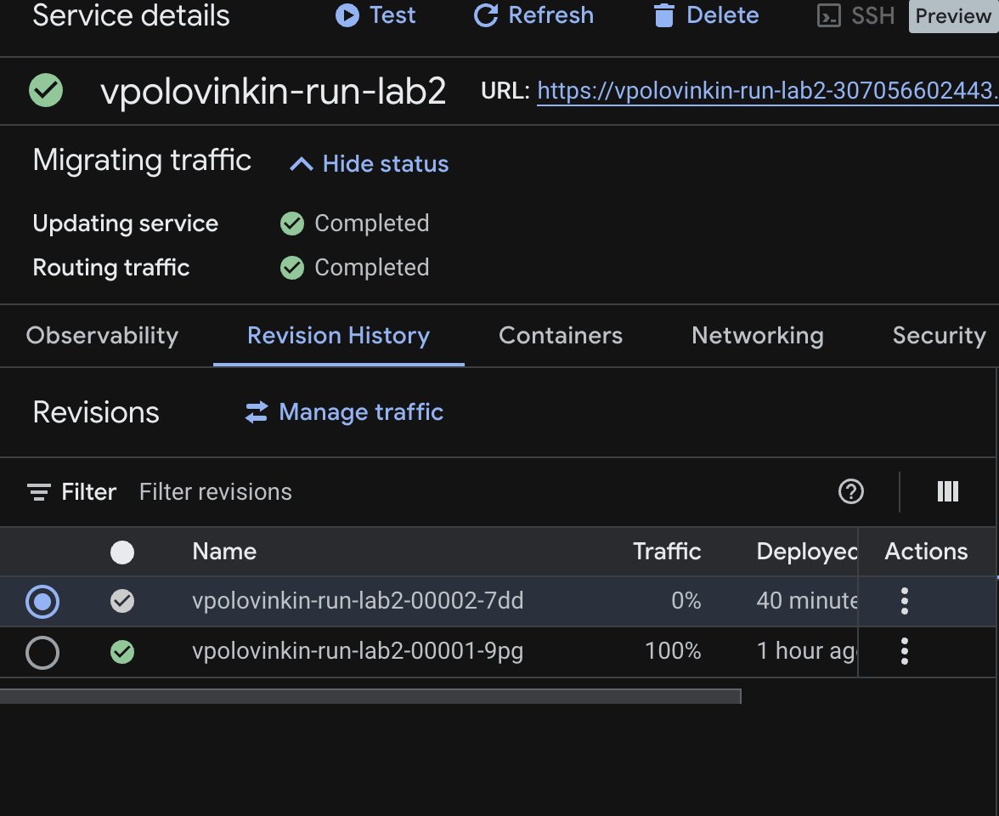

*Рисунок 22. Откат: 100% трафика на ревизию 00001-9pg*

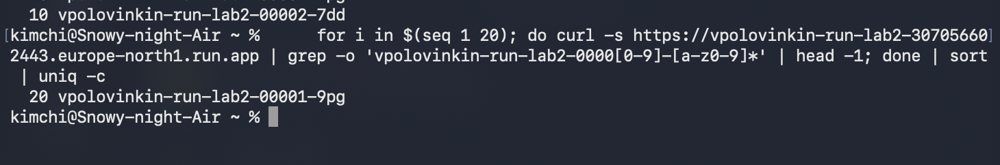

*Рисунок 23. После отката все 20 запросов обработала ревизия 00001-9pg*

**Возврат на последнюю версию.** Режим Send all traffic to the latest revision: ревизия `00002-7dd` снова получает **100% (to latest)**. Пометка «to latest» значит, что трафик привязан к последней ревизии и любая следующая версия сразу получила бы весь трафик.

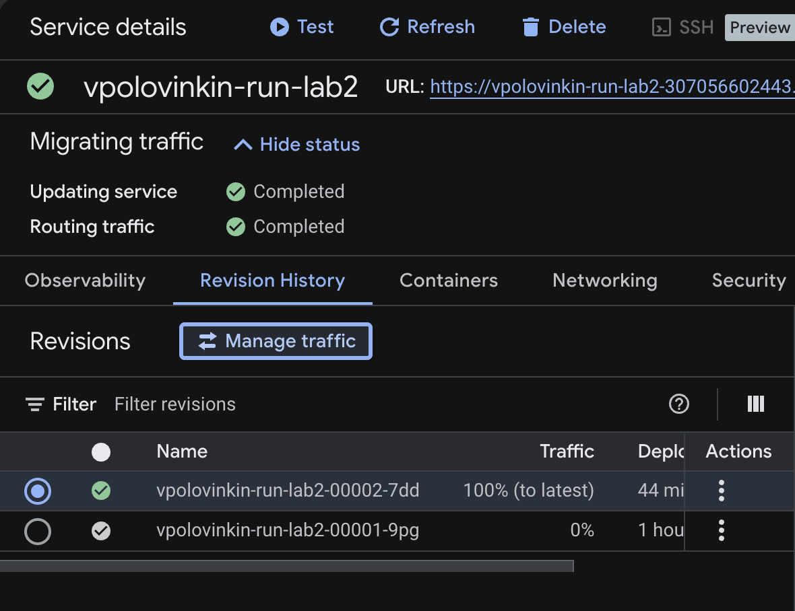

*Рисунок 24. Трафик снова идет на последнюю ревизию 00002-7dd*

**Сравнение версий:**

| Параметр | Ревизия 00001-9pg | Ревизия 00002-7dd |
| --- | --- | --- |
| Порт контейнера | 8080 | 8090 |
| Образ | Hello | Hello |
| Проверка запуска | Успешно, port 8080 | Успешно, port 8090 |
| Ответ сервиса | Страница Hello, код 200 | Страница Hello, код 200 |
| Внешний адрес | Тот же | Тот же |

| Режим трафика | 00001-9pg | 00002-7dd | Ответы на 20 запросов |
| --- | ---: | ---: | --- |
| После смены порта | 0% | 100% | Страница показывает 00002-7dd |
| Split 50/50 | 50% | 50% | 10 и 10 |
| Откат на одну ревизию | 100% | 0% | 20 от 00001-9pg |
| Возврат на последнюю | 0% | 100% (to latest) | не измерял |

Для пользователя обе версии работают одинаково: адрес тот же, страница та же, отличается только номер ревизии на странице и порт внутри контейнера.

### 7. Удаление созданных ресурсов

Я удалил сервис `vpolovinkin-run-lab2` кнопкой **Delete**, подтвердив удаление вводом имени сервиса. Вместе с сервисом удаляются обе его ревизии. Образ Hello я не создавал (он публичный, от Google), поэтому больше удалять было нечего.

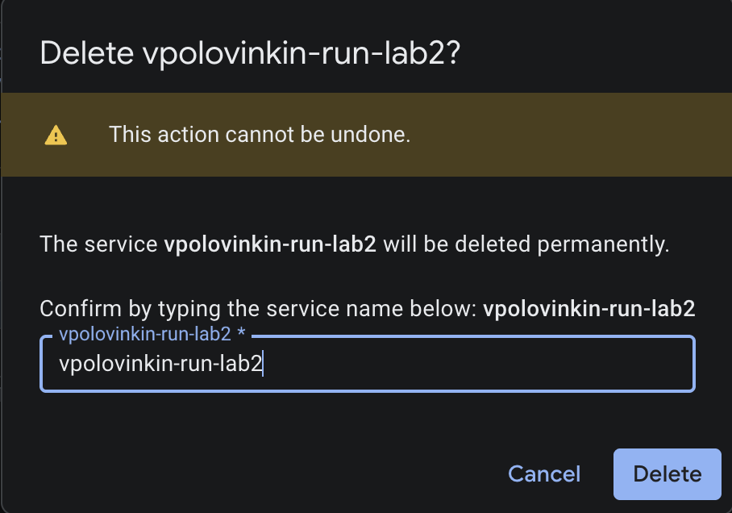

*Рисунок 25. Подтверждение удаления сервиса*

Страница сервиса после удаления сообщила, что ресурс `vpolovinkin-run-lab2` в регионе `europe-north1` не существует. В списке сервисов по фильтру `vpolovinkin` пусто.

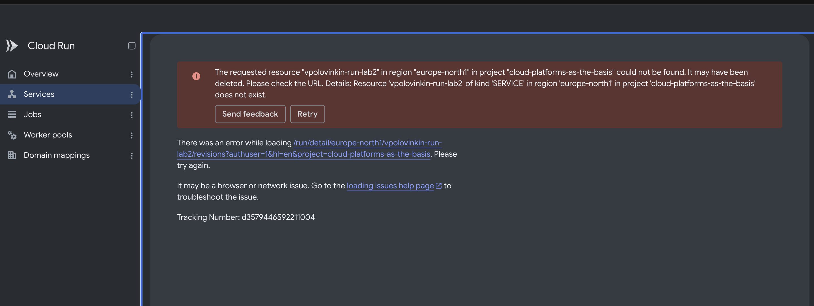

*Рисунок 26. Сервис больше не существует*

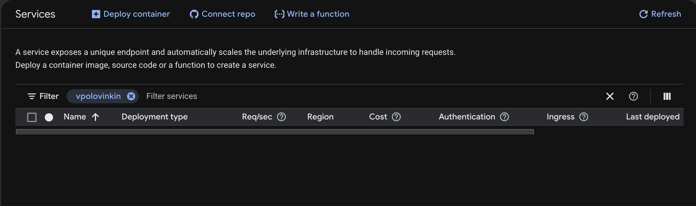

*Рисунок 27. В списке сервисов нет vpolovinkin-run-lab2*

Дополнительно я проверил, что адрес больше не отвечает. Команда выводит только код ответа сервера:

```bash
curl -s -o /dev/null -w "%{http_code}\n" https://vpolovinkin-run-lab2-307056602443.europe-north1.run.app
```

До удаления сервис отвечал кодом 200, после удаления пришел **404** (Not Found).

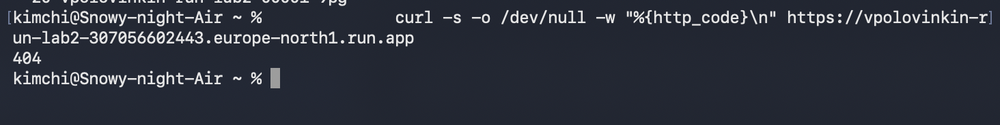

*Рисунок 28. После удаления адрес возвращает 404*

## Результаты

| Пункт методички | Результат |
| --- | --- |
| Cloud Run из сервиса Hello с минимальными ресурсами | Выполнено: `vpolovinkin-run-lab2`, 0.08 vCPU, 128 MiB, concurrency 1, первое поколение |
| Перейти по ссылке и протестировать | Выполнено: страница Hello, код 200 |
| Логи и метрики, анализ | Выполнено: запуск и проверка порта, холодный старт, автомасштабирование до 2 экземпляров, загрузка CPU около 4%, памяти до 17% |
| Порт 8090, что произойдет | Выполнено: новая ревизия `00002-7dd`, сервис работает, контейнер слушает 8090 через переменную `PORT` |
| Переключение трафика между версиями, сравнение | Выполнено: 50/50 (10 и 10 из 20), откат на `00001-9pg` (20 из 20), возврат на последнюю ревизию |
| Удалить созданные сервисы | Выполнено: сервис удален, адрес отвечает 404 |
| Отчет со скриншотами | Этот отчет |

## Вывод

В работе я развернул сервис в Cloud Run из готового контейнера Hello на минимальных ресурсах (0.08 vCPU и 128 MiB). Для этого пришлось включить оплату по запросам, ограничение в один запрос на экземпляр и первое поколение среды выполнения. Даже на таких ресурсах сервис работал без ошибок, а такая конфигурация примерно в 11 раз дешевле за секунду работы, чем 1 vCPU и 512 MiB. Логи и метрики показали, как устроена работа без серверов: экземпляры запускаются по запросам, первый запрос медленнее из-за холодного старта, а при ограничении в один запрос Cloud Run сам запускает дополнительный экземпляр. Смена порта на 8090 создала новую ревизию и не сломала сервис, потому что приложение берет порт из переменной окружения `PORT`. Ревизии позволяют выпускать новые версии без простоя: трафик можно делить между версиями и за секунды откатиться на старую. После работы сервис удален.

## Источники

1. [Методичка: Лабораторная работа №2](https://ex-itmo-ict-faculty.github.io/cloud-platforms-as-the-basis-of-technology-entrepreneurship/education/labs2023-2024/lab2/lab2/)
2. [Правила оформления отчетов](https://ex-itmo-ict-faculty.github.io/cloud-platforms-as-the-basis-of-technology-entrepreneurship/education/labs2023-2024/reportdesign/)
3. [Cloud Run: Configure CPU limits for services](https://docs.cloud.google.com/run/docs/configuring/services/cpu)
4. [Cloud Run: Configure memory limits for services](https://docs.cloud.google.com/run/docs/configuring/services/memory-limits)
5. [Cloud Run: Select an execution environment for services](https://docs.cloud.google.com/run/docs/configuring/execution-environments)
6. [Cloud Run: Set maximum instances for services](https://docs.cloud.google.com/run/docs/configuring/max-instances)
7. [Cloud Run: Container runtime contract](https://docs.cloud.google.com/run/docs/container-contract)
8. [Cloud Run: Rollbacks, gradual rollouts, and traffic migration](https://docs.cloud.google.com/run/docs/rollouts-rollbacks-traffic-migration)
9. [Cloud Run: Pricing](https://cloud.google.com/run/pricing)
10. [Cloud Run: Locations](https://docs.cloud.google.com/run/docs/locations)
11. [Исходный код сервиса Hello (GoogleCloudPlatform/cloud-run-hello)](https://github.com/GoogleCloudPlatform/cloud-run-hello)
