University: [ITMO University](https://itmo.ru/ru/)  
Faculty: [FTMI](https://en.itmo.ru/en/faculty/87/Faculty_of_Technological_Management_and_Innovations.htm)  
Course: [Cloud platforms as the basis of technology entrepreneurship](https://ex-itmo-ict-faculty.github.io/cloud-platforms-as-the-basis-of-technology-entrepreneurship/)  
Year: 2026/2027  
Group: U4225  
Author: Половинкин Валерий Валерьевич  
Lab: Lab3  
Date of create: 03.11.2026  
Date of finished:  

# Лабораторная работа №3 «Исследование Cloud Storage»

## Цель работы

Ознакомиться с основными понятиями и принципами работы облачного хранилища, изучить различные модели хранения данных (блочное, файловое и объектное хранилище), познакомиться с основными сервисами и функциями, которые предоставляют облачные хранилища.

## Задание

По методичке нужно было:

1. Выбрать существующий проект, в котором есть соответствующие разрешения.
2. Создать Cloud Storage bucket.
3. Загрузить в бакет 3-4 любых изображения.
4. Создать папку с любым названием и переместить файлы туда в пределах бакета.
5. Настроить публичный доступ для файлов в настройках приватности.
6. Создать ссылку на файлы через контекстное меню файла.
7. Удалить все созданные сервисы и написать отчет со скриншотами.

## Модели хранения данных

Облачные платформы предлагают три основные модели хранения. Описания и соответствующие сервисы Google Cloud взяты со страницы Google Cloud «Object Storage vs Block Storage vs File Storage».

| Модель | Как устроены данные | Где применяется | Сервис Google Cloud |
| --- | --- | --- | --- |
| Блочное хранилище | Данные разбиты на блоки фиксированного размера, каждый блок можно читать и записывать отдельно | Диски виртуальных машин, базы данных, транзакционные нагрузки | Persistent Disk, Local SSD |
| Файловое хранилище | Файлы лежат в папках и подпапках, к файлу обращаются по точному пути | Общие сетевые папки, совместная работа с документами | Filestore |
| Объектное хранилище | Данные хранятся как отдельные объекты в плоском пространстве, у каждого объекта есть уникальный идентификатор и метаданные | Большие объемы неструктурированных данных: медиафайлы, резервные копии, архивы, данные для аналитики | Cloud Storage |

С блочным хранилищем я уже работал в лабораторной №1: загрузочный диск виртуальной машины был Persistent Disk. В этой работе изучается объектное хранилище Cloud Storage.

Основные понятия Cloud Storage:

- **Бакет (bucket)** это контейнер для объектов. Имя бакета должно быть уникальным среди всех пользователей Cloud Storage, а не только внутри проекта, и оно видно публично, поэтому по документации в имени нельзя указывать почты и другие личные данные.
- **Объект** это файл вместе с его метаданными (размер, тип, дата создания).
- **Папки.** В обычном бакете (без иерархического пространства имен) папок на самом деле нет. По документации Google строка `folder1/` является просто частью имени объекта, а консоль показывает «папки», разбивая имена по символу `/`. Когда в консоли создают пустую папку, Cloud Storage записывает объект нулевого размера с именем, которое заканчивается на `/`.

## Ход работы

### 1. Проект

Работа выполнена в учебном проекте `cloud-platforms-as-the-basis`, к которому преподаватель выдал доступ (он виден в верхней панели консоли на рисунке 5). Проект общий для всей группы, поэтому бакет я назвал со своим префиксом и не трогал чужие ресурсы, в том числе бакет преподавателя `lab1-bucket-itmo` из лабораторной №1.

### 2. Создание бакета

В разделе **Cloud Storage → Buckets → Create** я задал следующие параметры:

| Параметр | Значение | Почему так |
| --- | --- | --- |
| Name | `vpolovinkin-bucket-lab3` | Уникальное имя по тому же шаблону, что в прошлых работах, без личных данных |
| Location type | Region | Для трех-четырех картинок достаточно одного региона. По умолчанию стоял Multi-region `us` |
| Location | `europe-north1 (Finland)` | Тот же регион, что в лабораторных №1 и №2. Консоль предупреждает, что расположение нельзя изменить после создания |
| Default storage class | Standard | Класс для данных, к которым часто обращаются |
| Hierarchical namespace, Rapid Cache | Выключены | Не нужны для задания |
| Enforce public access prevention | Снята | Иначе на шаге 5 открыть публичный доступ было бы нельзя |
| Access control | Uniform | Доступ задается на уровне всего бакета через IAM, Google рекомендует этот вариант |
| Soft delete policy | Снята | По документации с этой политикой удаленные объекты и бакет хранятся еще 7 дней и за хранение продолжают начисляться деньги. Мне нужно было, чтобы при удалении все исчезло сразу |
| Object versioning, Retention | Выключены | Не нужны для задания |

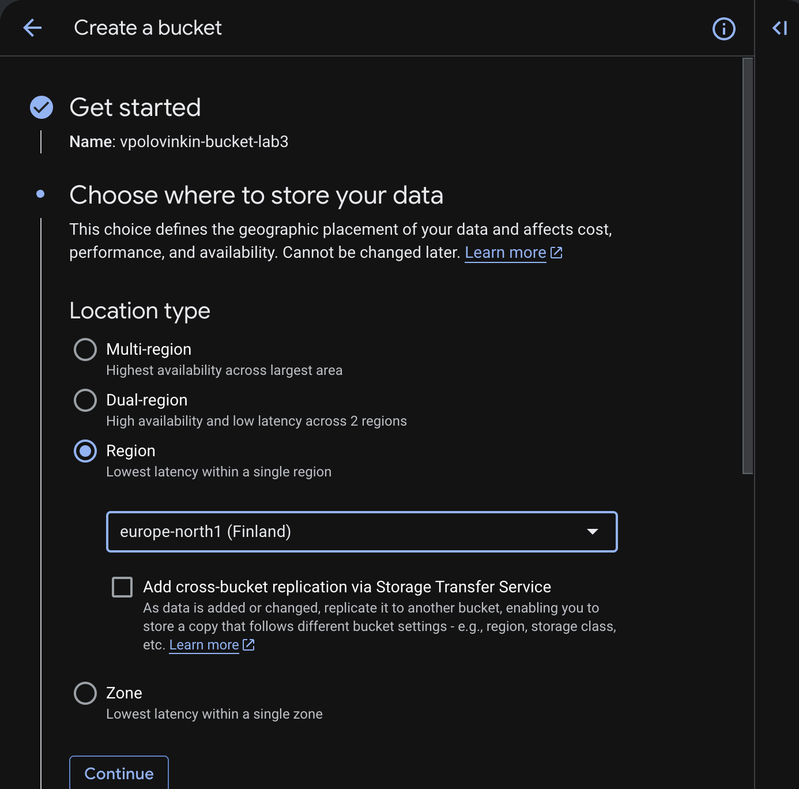

*Рисунок 1. Имя бакета и регион europe-north1*

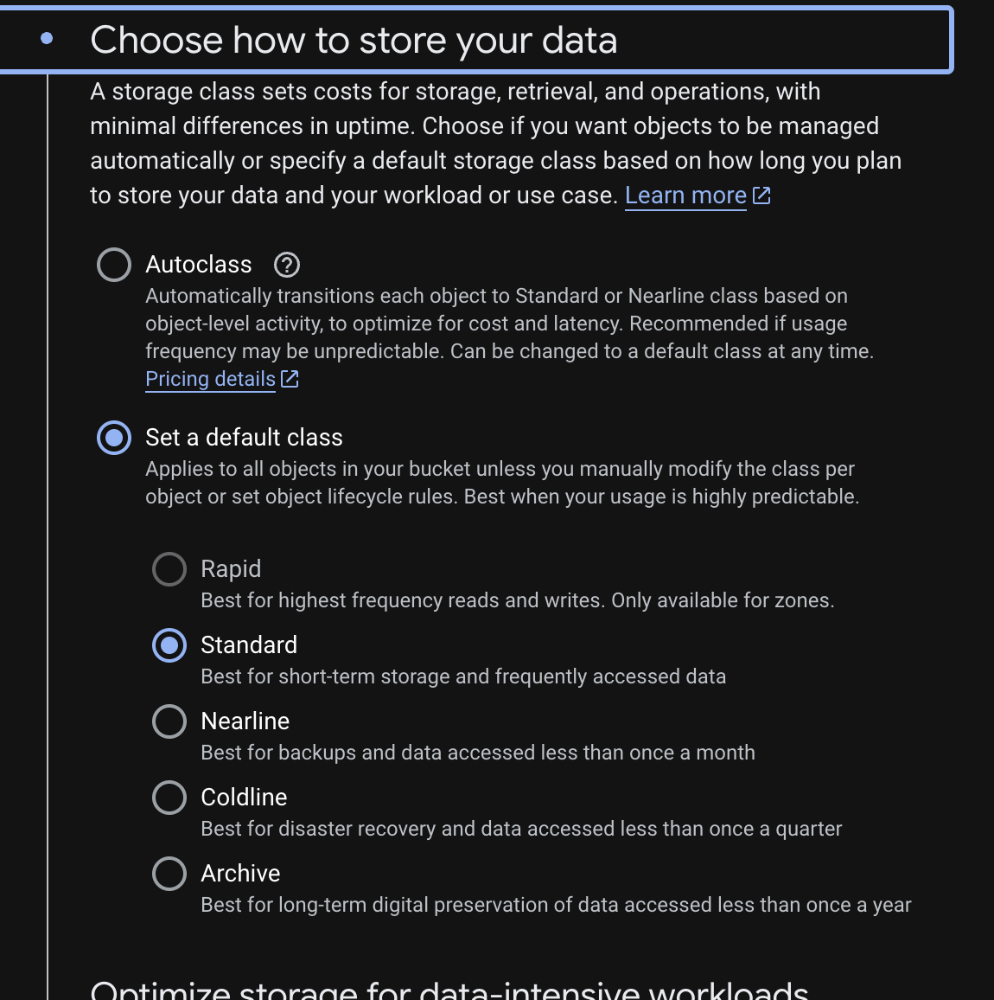

*Рисунок 2. Класс хранения Standard*

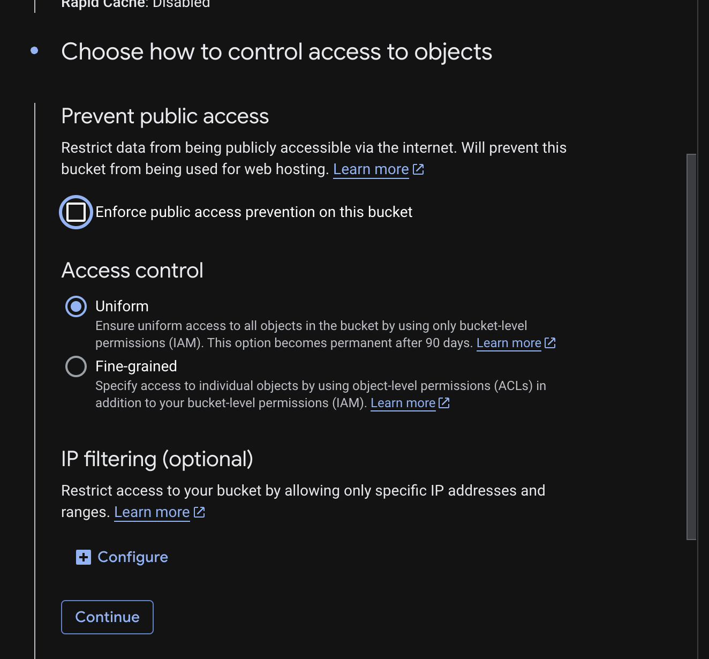

*Рисунок 3. Защита от публичного доступа снята, контроль доступа Uniform*

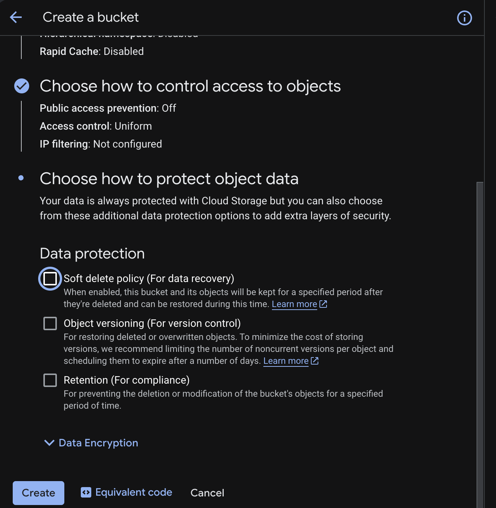

*Рисунок 4. Soft delete, версии и Retention выключены*

Бакет создался («Created bucket vpolovinkin-bucket-lab3»). В его шапке видно: Location europe-north1 (Finland), Storage class Standard, **Public access: Not public**, Protection: None. Снятая галочка защиты от публичного доступа только разрешает открыть доступ, сама по себе она бакет публичным не делает.

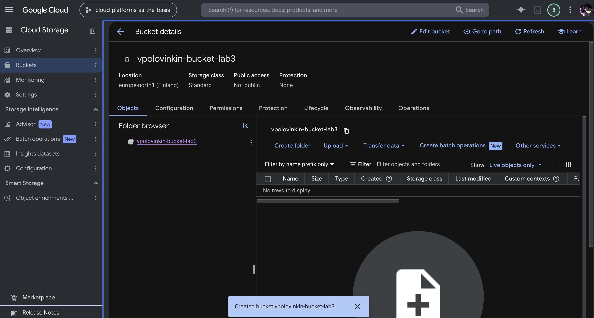

*Рисунок 5. Созданный пустой бакет*

### 3. Загрузка изображений

Через **Upload → Upload files** я загрузил в корень бакета четыре изображения:

| Файл | Размер | Тип |
| --- | ---: | --- |
| image_1.png | 156 B | image/png |
| image_2.svg | 406 B | image/svg+xml |
| image_3.png | 534 B | image/png |
| image_4.svg | 433 B | image/svg+xml |

Консоль сообщила «4 files successfully uploaded», тип каждого файла показан в колонке Type.

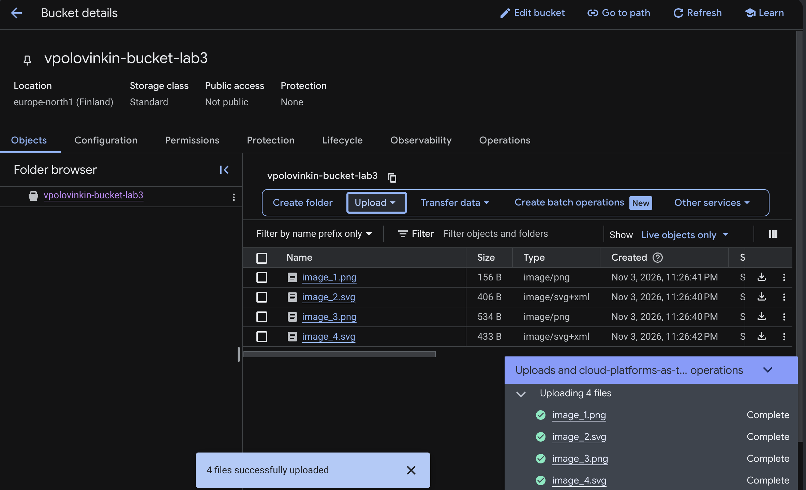

*Рисунок 6. Четыре изображения в корне бакета*

### 4. Папка и перемещение файлов

Кнопкой **Create folder** я создал папку `lab3-images`. Она появилась в списке как `lab3-images/` рядом с картинками.

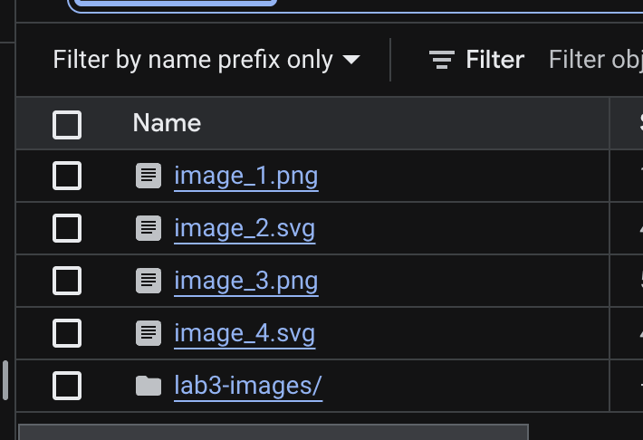

*Рисунок 7. Папка lab3-images*

Перемещение делается через меню файла (три точки справа в строке) → **Move**.

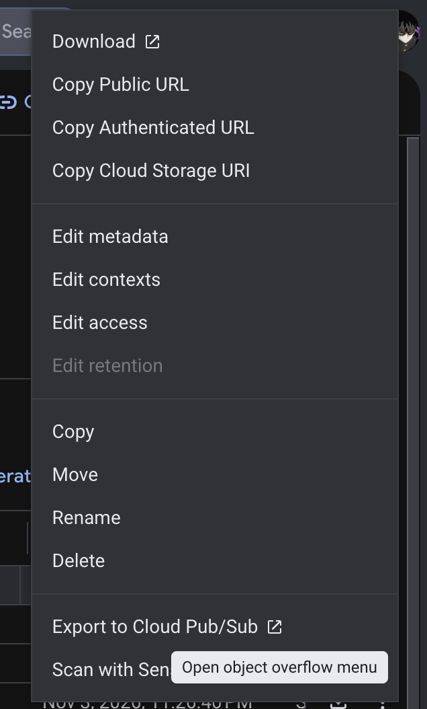

*Рисунок 8. Меню файла с пунктом Move*

С первого раза перемещение не получилось. Ниже описано, что я пробовал, потому что по ходу стало понятно, какой формат пути нужен консоли.

**Попытка 1: Move с путем `lab3-images`.** В поле Destination было указано только имя папки. Консоль ответила: «Unable to move your object. Your billing account is absent». Почему пришло именно сообщение про платежный аккаунт, я точно не установил. Загрузка файлов в этом же проекте до и после этого работала, а при полном пути (попытка 4) перемещение прошло без ошибок.

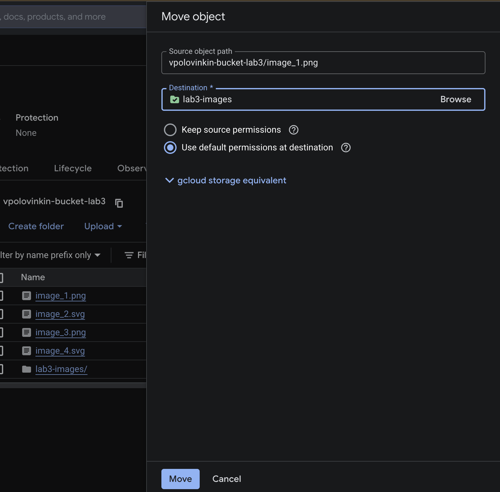

*Рисунок 9. Окно Move с коротким путем*

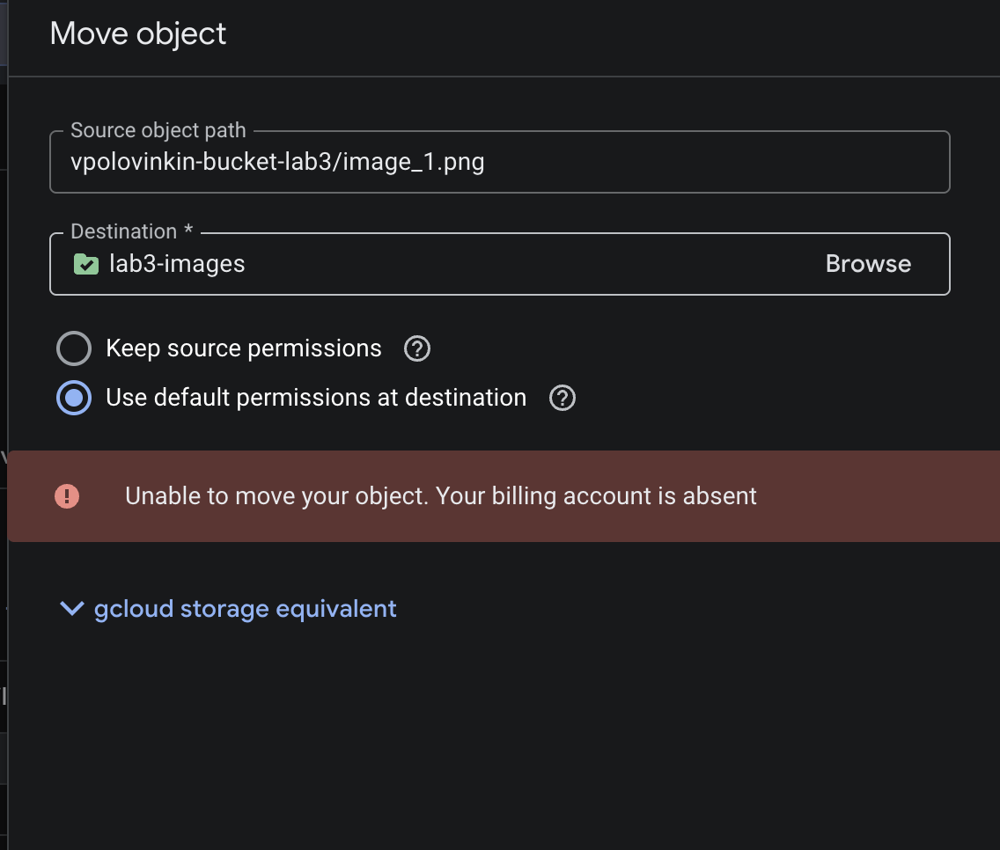

*Рисунок 10. Ошибка при первой попытке перемещения*

**Попытка 2: Rename.** Раз папка это часть имени объекта, я попробовал переименовать `image_1.png` в `lab3-images/image_1.png`. Консоль это запрещает: «Forward slashes (/) are not allowed in object names». То есть в консоли через переименование файл в папку не перенести.

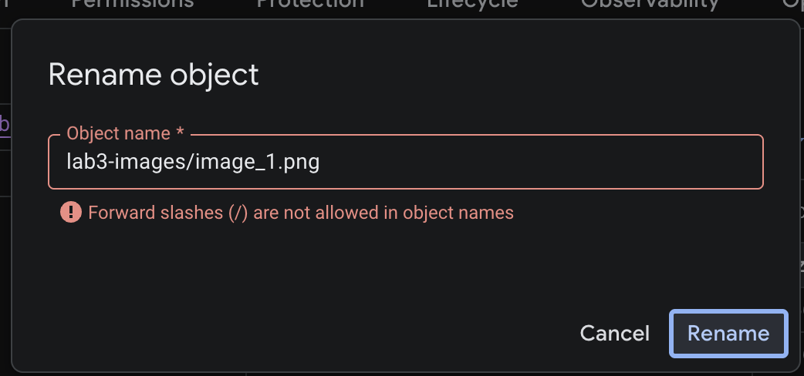

*Рисунок 11. Rename не принимает символ / в имени*

**Попытка 3: проверка записи и Copy.** Чтобы убедиться, что запись в проект вообще работает, я загрузил копии картинок прямо в папку через Upload, это прошло успешно. Затем скопировал `image_1.png` в папку через **Copy**. Для Copy консоль требует путь в формате `bucket/object` или `bucket/folder/object`. С путем `vpolovinkin-bucket-lab3/lab3-images/image_1.png` копирование прошло («Copied object to vpolovinkin-bucket-lab3/lab3-images/image_1.png»).

**Попытка 4: Move с полным путем к папке.** Для Move консоль требует путь к бакету или папке со слешем на конце («The destination must be a bucket or folder path (ending in a slash)»). С путем `vpolovinkin-bucket-lab3/lab3-images/` перемещение прошло: «Moved object to vpolovinkin-bucket-lab3/lab3-images/image_2.svg».

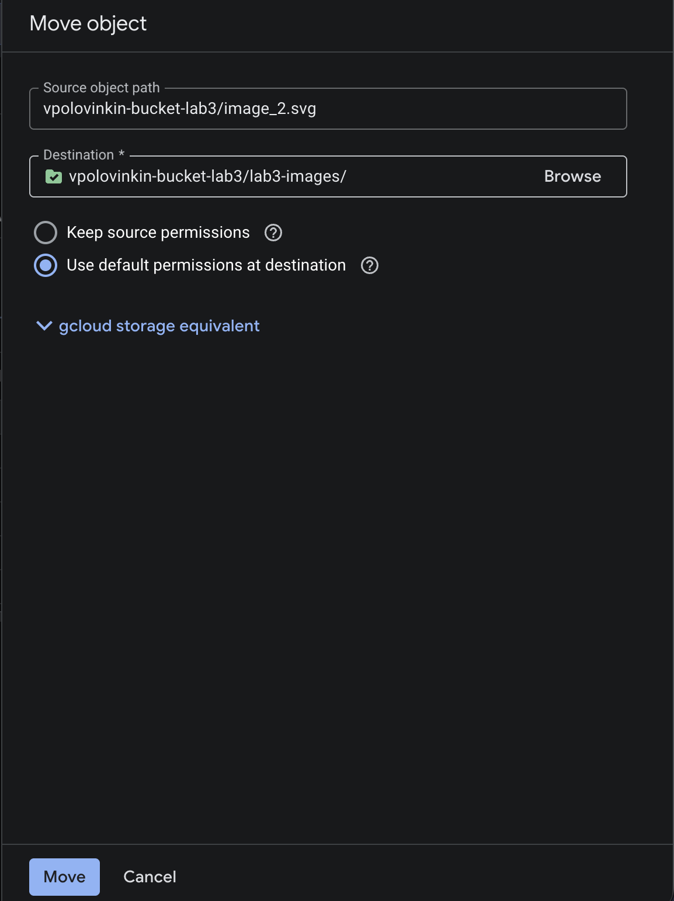

*Рисунок 12. Move с путем vpolovinkin-bucket-lab3/lab3-images/*

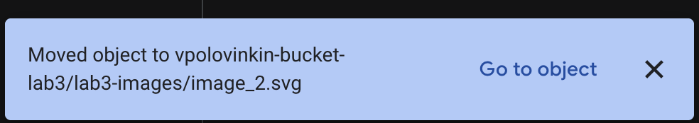

*Рисунок 13. Файл перемещен в папку*

Так же через Move я перенес `image_3.png`, `image_4.svg` и `image_1.png`. Поскольку в папке уже лежали копии из попытки 3, консоль каждый раз спрашивала, перезаписать ли файл (Confirm overwrite), и я подтверждал. В итоге все четыре файла в папке получены перемещением из корня бакета, а копии из попытки 3 перезаписаны.

Результат: в корне бакета осталась только папка `lab3-images/`, а в ней четыре картинки с теми же размерами.

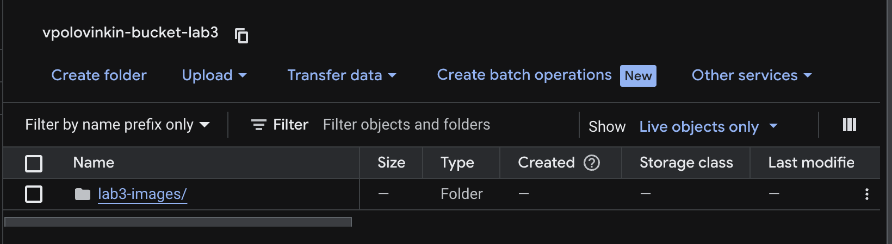

*Рисунок 14. В корне бакета только папка*

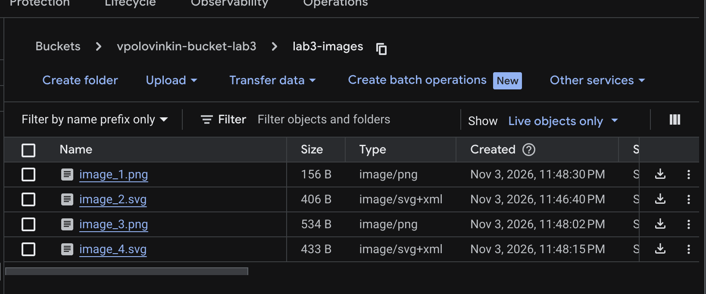

*Рисунок 15. Четыре изображения в папке lab3-images*

Время в колонке Created у файлов в папке новое: 11:46-11:48 PM вместо 11:26 PM при загрузке. То есть в папке оказались новые объекты с новыми именами, а не «переложенные» старые. Это соответствует устройству хранилища: папок как отдельных сущностей нет, и перенос в папку означает запись объекта под другим именем.

### 5. Публичный доступ

На вкладке **Permissions** бакета я нажал **Grant access** и добавил:

- **New principals:** `allUsers`. По документации Google это «anyone who is on the internet, including authenticated and unauthenticated users», то есть любой человек в интернете, с аккаунтом Google или без.
- **Role:** **Storage Object Viewer**. Описание роли в консоли: «Grants access to view objects and their metadata, excluding ACLs. Can also list the objects in a bucket». Роль дает только чтение, изменять и удалять файлы она не позволяет.

Консоль предупредила желтой плашкой: «Adding "allUsers" makes this resource public and accessible to anyone on the internet». После сохранения я подтвердил публичный доступ.

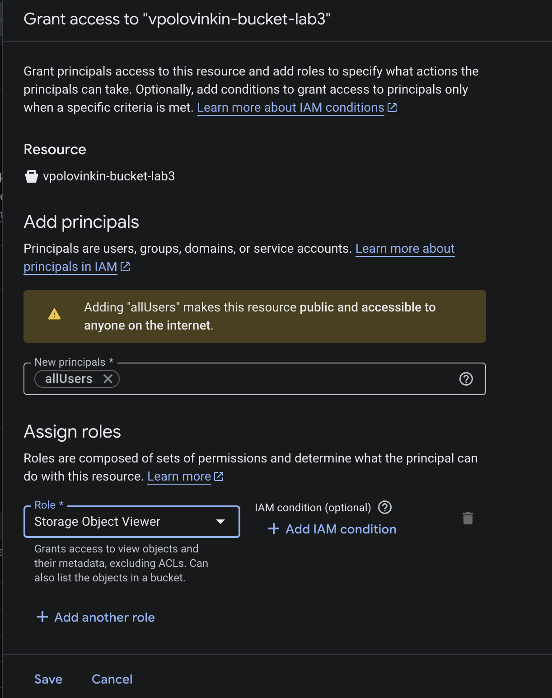

*Рисунок 16. Выдача роли Storage Object Viewer для allUsers*

Статус бакета сменился на **Access granted to public principals**, а консоль сообщила «Policy updated. It may take a few minutes for these changes to become active». В подсказке консоль также предупреждает, что публичный доступ может блокировать политика организации, и проверить это без отдельного права нельзя. Поэтому доступность я проверил по факту в следующем пункте.

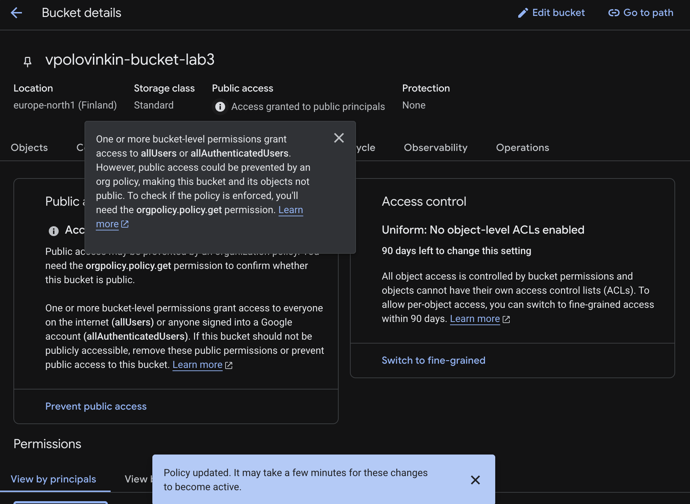

*Рисунок 17. Бакет стал публичным*

Так как выбран режим Uniform, правило действует на весь бакет сразу, то есть публичными стали все файлы в нем, а не отдельные. В лабораторной №1 у бакета преподавателя `lab1-bucket-itmo` я видел точно такое же правило (`allUsers` с ролью `roles/storage.objectViewer`), здесь я настроил его сам.

### 6. Ссылка через контекстное меню файла

В папке `lab3-images` в меню файла я выбрал **Copy Public URL**. В этом же меню есть **Copy Authenticated URL** и **Copy Cloud Storage URI**, но для открытия без входа в аккаунт нужна именно публичная ссылка.

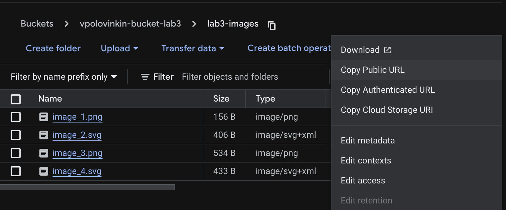

*Рисунок 18. Пункт Copy Public URL в меню файла*

Публичная ссылка имеет вид `https://storage.googleapis.com/<бакет>/<имя объекта>`:

```text
https://storage.googleapis.com/vpolovinkin-bucket-lab3/lab3-images/image_1.png
```

Я открыл ссылки в окне инкогнито Chrome, где я не вошел в аккаунт Google. Обе картинки открылись: `image_1.png` (красный квадрат 250×250 пикселей) и `image_2.svg` (сетка 3×3 из синих квадратов).

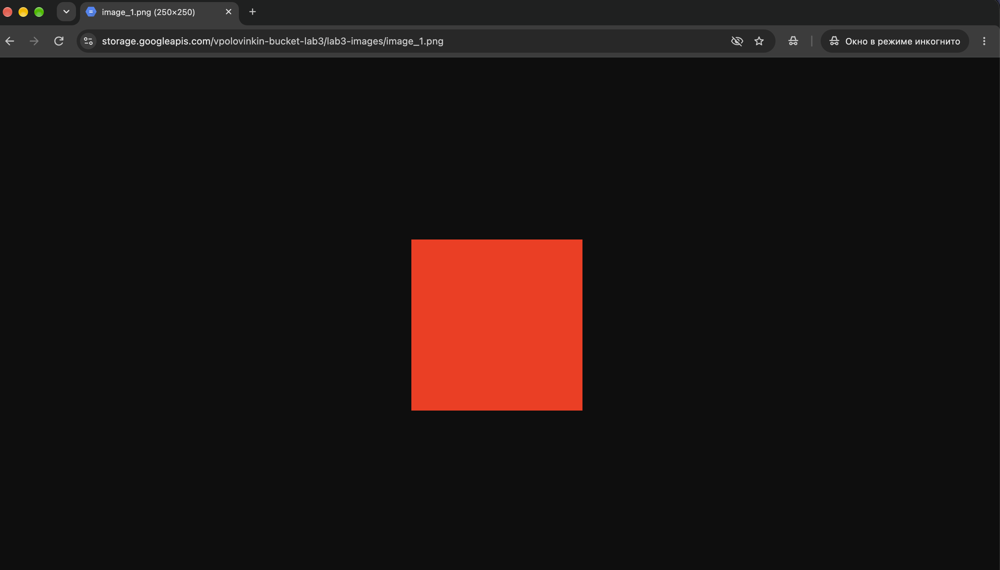

*Рисунок 19. image_1.png открывается без входа в аккаунт*

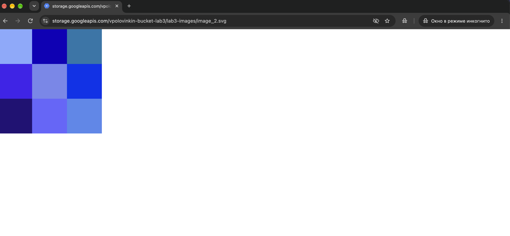

*Рисунок 20. image_2.svg открывается без входа в аккаунт*

Дополнительно я проверил все четыре файла из терминала на своем компьютере. Этого нет в методичке, я добавил проверку, чтобы подтвердить доступность каждого файла. Команда выводит HTTP-код ответа: 200 значит, что файл отдается.

```bash
for f in image_1.png image_2.svg image_3.png image_4.svg; do echo "$f: $(curl -s -o /dev/null -w '%{http_code}' https://storage.googleapis.com/vpolovinkin-bucket-lab3/lab3-images/$f)"; done
```

Все четыре файла вернули **200**, значит, политика организации публичный доступ не блокирует.

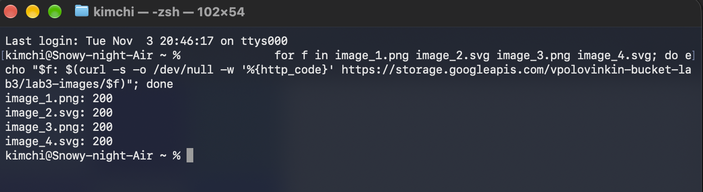

*Рисунок 21. Все четыре файла доступны публично*

### 7. Удаление бакета

В списке бакетов я поставил фильтр `vpolovinkin`, выбрал только свой бакет и нажал **Delete**. Консоль предупредила, что бакет и все объекты в нем будут удалены навсегда («Data will not be recoverable»), и попросила ввести слово `DELETE`. Удаление выполняется в фоне. Вместе с бакетом удалились папка, четыре файла и правило публичного доступа.

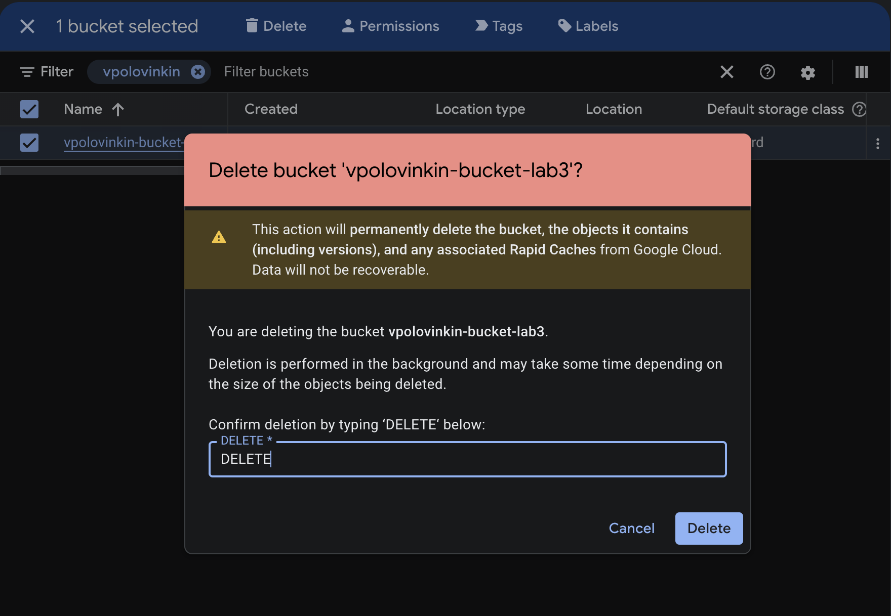

*Рисунок 22. Подтверждение удаления бакета*

Консоль сообщила «Deleted 1 bucket», список по фильтру `vpolovinkin` пуст.

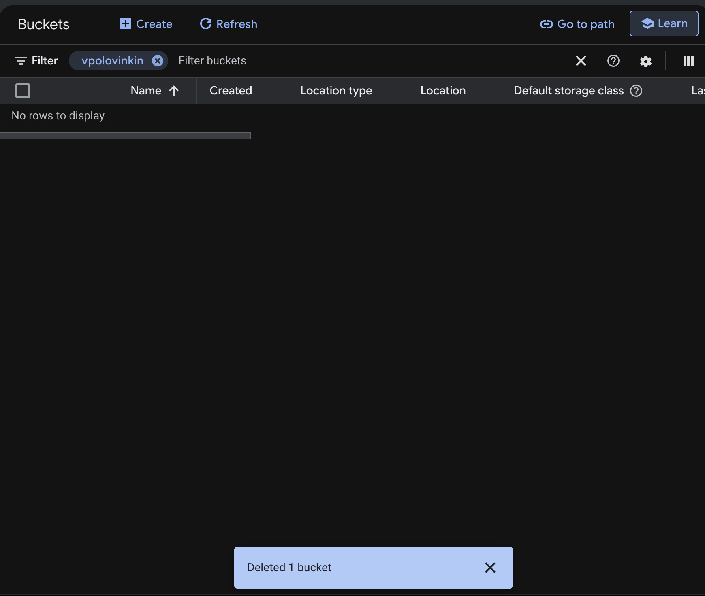

*Рисунок 23. Бакета vpolovinkin-bucket-lab3 больше нет*

Затем я снова проверил ссылки той же командой. При первой проверке сразу после удаления `image_1.png` еще вернул **200**, а остальные три файла уже **404**.

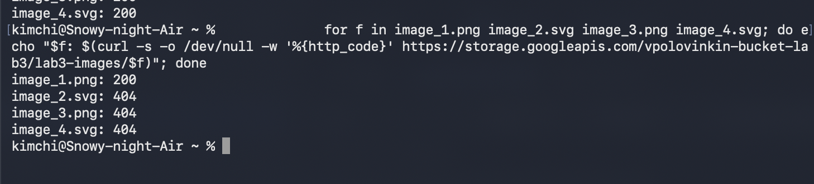

*Рисунок 24. Первая проверка после удаления*

Объяснение, которое я считаю наиболее вероятным, это кэш. По документации Google у публичных объектов по умолчанию стоит `Cache-Control: public, max-age=3600`, то есть копию файла можно хранить в кэше до часа, и там же сказано, что после отзыва публичного доступа объект еще может отдаваться из кэша. Именно `image_1.png` я открывал чаще всех. Вторая возможная причина: удаление бакета выполняется в фоне. Какая из причин сработала, проверить я уже не смог: при следующей проверке через несколько минут сервер для `image_1.png` вернул `HTTP/2 404` с заголовком `cache-control: private, max-age=0`, а повтор команды показал **404** для всех четырех файлов.

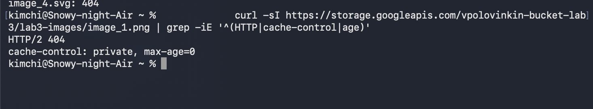

*Рисунок 25. Заголовки ответа для image_1.png: 404*

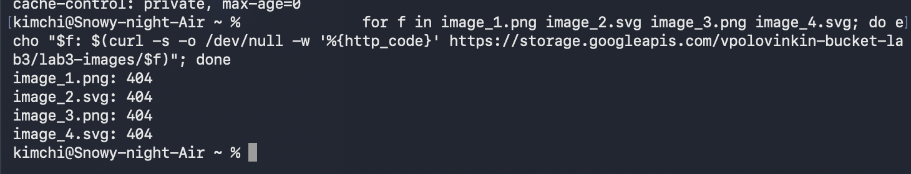

*Рисунок 26. После удаления все четыре ссылки возвращают 404*

## Результаты

| Пункт методички | Результат |
| --- | --- |
| Выбрать проект с разрешениями | Выполнено: `cloud-platforms-as-the-basis` |
| Создать бакет | Выполнено: `vpolovinkin-bucket-lab3`, europe-north1, Standard, Uniform |
| Загрузить 3-4 изображения | Выполнено: 4 файла (2 PNG, 2 SVG) |
| Создать папку и переместить файлы в пределах бакета | Выполнено: папка `lab3-images`, все 4 файла перенесены через Move. Рабочий формат пути: `bucket/folder/` |
| Настроить публичный доступ | Выполнено: `allUsers` с ролью Storage Object Viewer, статус «Access granted to public principals» |
| Создать ссылку через контекстное меню | Выполнено: Copy Public URL, ссылки открываются в инкогнито, все 4 файла отдают 200 |
| Удалить созданные ресурсы | Выполнено: бакет удален, все ссылки отдают 404 |
| Отчет со скриншотами | Этот отчет |

## Вывод

В работе я разобрал три модели хранения данных и на практике поработал с объектным хранилищем Google Cloud Storage: создал бакет в регионе europe-north1, загрузил изображения, разложил их по папке, открыл к ним публичный доступ и получил публичные ссылки. Работа показала, что «папки» в Cloud Storage существуют только как часть имени объекта, поэтому перенос в папку означает запись объекта под новым именем, а консоль требует для этого полный путь к папке. Публичный доступ задается не для каждого файла отдельно, а правилом на весь бакет (`allUsers` с ролью Storage Object Viewer), и после этого любой файл открывается по ссылке без входа в аккаунт. При удалении я увидел, что публичный файл может еще какое-то время отдаваться по ссылке, вероятно из кэша, поэтому открывать в публичный доступ стоит только то, что не жалко показать всем. После работы бакет удален, ресурсов в общем проекте не осталось.

## Источники

1. [Методичка: Лабораторная работа №3](https://ex-itmo-ict-faculty.github.io/cloud-platforms-as-the-basis-of-technology-entrepreneurship/education/labs2023-2024/lab3/lab3/)
2. [Правила оформления отчетов](https://ex-itmo-ict-faculty.github.io/cloud-platforms-as-the-basis-of-technology-entrepreneurship/education/labs2023-2024/reportdesign/)
3. [Google Cloud: Object Storage vs Block Storage vs File Storage](https://cloud.google.com/discover/object-vs-block-vs-file-storage)
4. [Cloud Storage: Create a bucket](https://docs.cloud.google.com/storage/docs/creating-buckets)
5. [Cloud Storage: About Cloud Storage buckets (правила имен)](https://docs.cloud.google.com/storage/docs/naming-buckets)
6. [Cloud Storage: Soft delete overview](https://docs.cloud.google.com/storage/docs/soft-delete)
7. [Cloud Storage: About Cloud Storage objects (папки)](https://docs.cloud.google.com/storage/docs/folders)
8. [Cloud Storage: Copy, rename, and move objects](https://docs.cloud.google.com/storage/docs/copying-renaming-moving-objects)
9. [Cloud Storage: Make data public](https://docs.cloud.google.com/storage/docs/access-control/making-data-public)
10. [IAM roles for Cloud Storage](https://docs.cloud.google.com/storage/docs/access-control/iam-roles)
11. [IAM principals (allUsers)](https://docs.cloud.google.com/iam/docs/principals-overview)
12. [Cloud Storage: Object metadata (Cache-Control)](https://docs.cloud.google.com/storage/docs/metadata)
