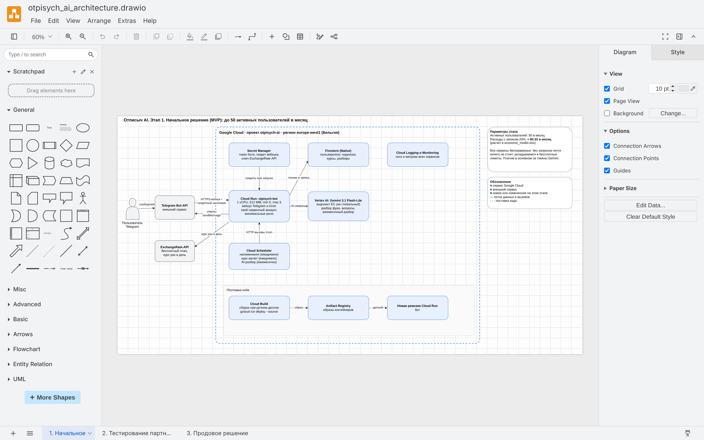
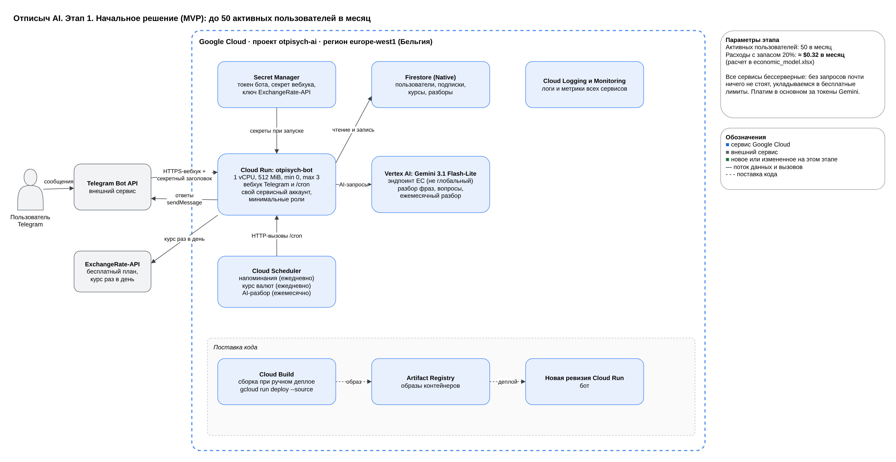
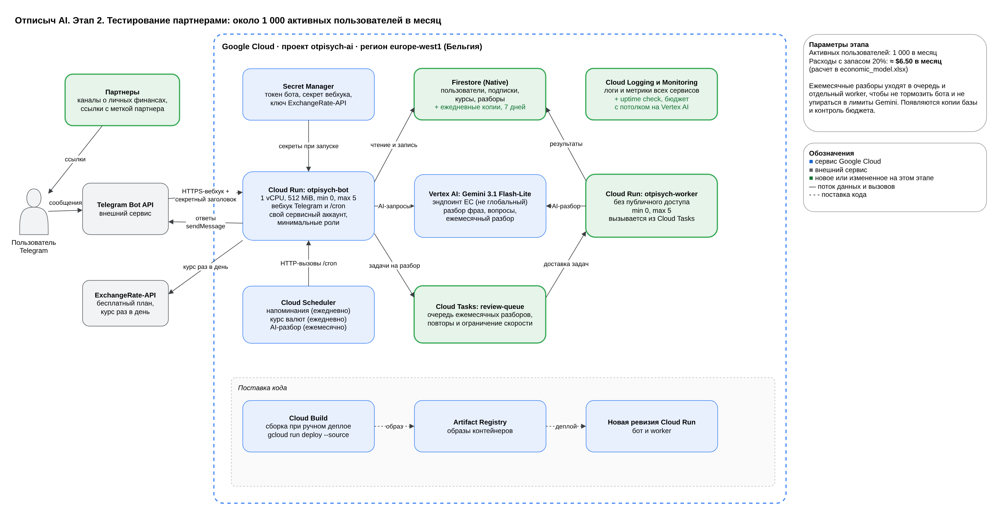
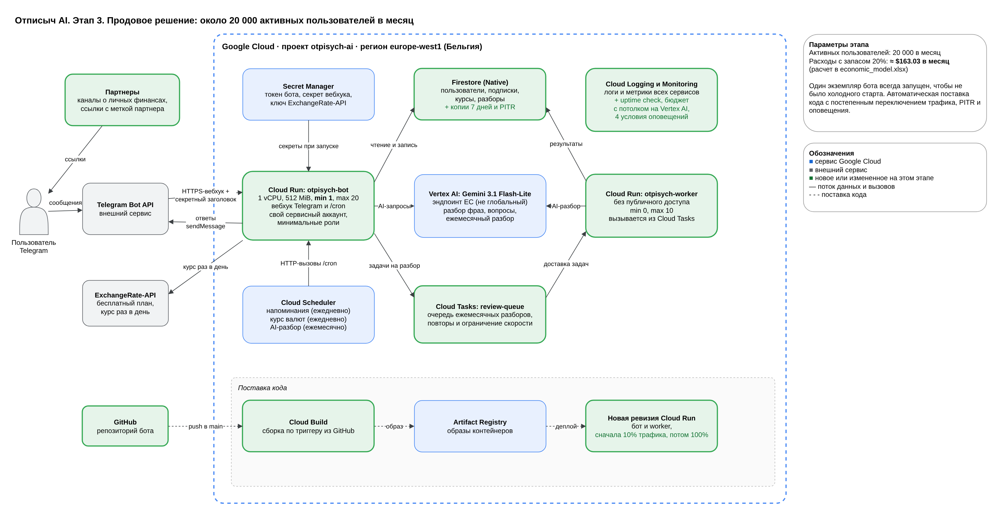
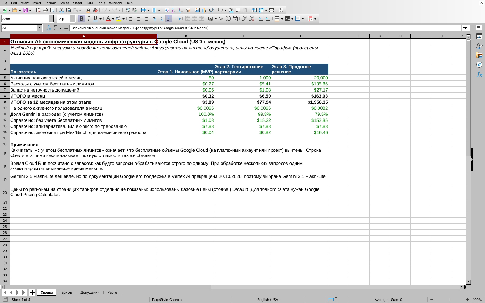

University: [ITMO University](https://itmo.ru/ru/)  
Faculty: [FTMI](https://en.itmo.ru/en/faculty/87/Faculty_of_Technological_Management_and_Innovations.htm)  
Course: [Cloud platforms as the basis of technology entrepreneurship](https://ex-itmo-ict-faculty.github.io/cloud-platforms-as-the-basis-of-technology-entrepreneurship/)  
Year: 2026/2027  
Group: U4225  
Author: Половинкин Валерий Валерьевич  
Lab: Lab4  
Date of create: 04.11.2026  
Date of finished: 06.11.2026  

# Лабораторная работа №4 «Разработка инфраструктуры MVP AI приложения»

## Цель работы

Создать прототип AI-приложения с базовой функциональностью.

## Задание

По методичке нужно было:

1. Из исходных данных о приложении накидать схему инфраструктуры в draw.io.
2. Посчитать экономическую модель (расходы на содержание) и обосновать выбор тех или иных ресурсов.
3. Учесть, что у приложения 3 состояния: начальное, тестирование партнерами и продовое решение.
4. Заранее подумать, какое решение будет оптимальным при предполагаемых нагрузках. Самое дешевое решение на первом этапе не всегда оптимально в дальнейшем.

Практической части с созданием ресурсов в облаке в этой работе нет, поэтому в учебном проекте Google Cloud я ничего не создавал. Исходные данные о приложении в методичке не даны, поэтому идею, функции и нагрузки я задал сам. Все допущения перечислены ниже и вынесены на отдельный лист Excel, их можно поменять, и модель пересчитается.

## Файлы работы

| Файл | Что внутри |
| --- | --- |
| [otpisych_ai_architecture.drawio](otpisych_ai_architecture.drawio) | Схема инфраструктуры в draw.io, 3 вкладки: «1. Начальное», «2. Тестирование партнерами», «3. Продовое решение» |
| [economic_model.xlsx](economic_model.xlsx) | Экономическая модель: листы «Сводка», «Тарифы», «Допущения», «Расчет». Все итоги считаются формулами |
| `images/` | Картинки схем, выгруженные из draw.io, и скриншоты |

*Рисунок 1. Файл схемы открыт в draw.io, внизу видны 3 вкладки по трем состояниям приложения*

## Идея приложения: «Отписыч AI»

За основу я взял своего Telegram-бота «Отписыч» из курса «Vibe Coding: AI-боты для бизнеса». Бот хранит список подписок пользователя (сервис, сумма, валюта, день списания), напоминает о списаниях и пересчитывает суммы в другую валюту по курсу ExchangeRate-API. В том курсе бот работал на Railway и хранил данные в SQLite.

«Отписыч AI» это та же идея, но с тремя AI-функциями на Gemini:

1. **Добавление подписки обычной фразой.** Пользователь пишет «нетфликс 799 рублей 15 числа», модель разбирает фразу на поля, бот показывает результат и просит подтвердить.
2. **Вопросы в свободной форме.** Например, «сколько я трачу в месяц в евро?» или «что у меня списывается на этой неделе?». Бот передает модели список подписок пользователя и вопрос.
3. **Ежемесячный разбор.** Раз в месяц бот присылает сводку: сколько ушло на подписки, какие похожи на лишние или дублирующиеся.

Это и есть базовая функциональность MVP: обычный бот-трекер плюс AI там, где он реально упрощает жизнь пользователю.

## Исходные данные и допущения

Нагрузку я считал через активного пользователя в месяц (MAU). Значения ниже это допущения, а не замеры работающего сервиса.

| Что делает один активный пользователь за месяц | Значение | Время обработки | Токены (вход / выход) |
| --- | --- | --- | --- |
| Обычные действия в боте (кнопки, список, смена валюты) | 40 запросов | 0.2 с | нет |
| AI-разбор фразы при добавлении подписки | 4 вызова | 2 с | 400 / 100 |
| Вопрос боту в свободной форме | 3 вызова | 4 с | 1 200 / 300 |
| Ежемесячный AI-разбор | 1 вызов | 8 с | 1 500 / 700 |
| Напоминания о списании | 3 сообщения | 0.1 с | нет |
| Повторы AI-вызовов (ошибки, повторная отправка) | +5% | | |
| Firestore: чтения / записи / удаления | 500 / 15 / 1 документ | | |
| Данные / логи / исходящий трафик | 15 KB / 150 KB / 150 KB | | |

| Параметр этапа | 1. Начальное | 2. Тестирование партнерами | 3. Продовое решение |
| --- | --- | --- | --- |
| Активных пользователей в месяц | 50 | 1 000 | 20 000 |
| Кто пользуется | я, друзья, одногруппники | аудитория партнеров | открытый запуск |
| Постоянно запущенных экземпляров бота | 0 | 0 | 1 |
| Очередь Cloud Tasks и отдельный worker | нет | да | да |
| Резервные копии Firestore / PITR | нет / нет | да / нет | да / да |
| Проверка доступности (uptime check) | нет | раз в 5 минут из 3 регионов | раз в 5 минут из 3 регионов |
| Условия оповещений | 0 | 0 | 4 |
| Поставка кода | вручную | вручную | автоматически из GitHub |

Ресурсы одного экземпляра Cloud Run: 1 vCPU и 512 MiB. В лабораторной №2 было видно, что при доле vCPU (0.08) Cloud Run требует concurrency 1, то есть один экземпляр обрабатывает только один запрос. Боту нужно одновременно ждать ответ модели для одного пользователя и отвечать другому, поэтому я взял целый vCPU. Памяти 512 MiB с запасом хватает Python-боту.

## Общие решения для всех этапов

### Платформа и регион

Платформа Google Cloud: с ней я работал в лабораторных №1-3, и в ней есть все нужное, включая модели Gemini в Vertex AI.

Регион **europe-west1 (Бельгия)**. В лабораторных №1-3 я работал в europe-north1, но по документации Google в этом регионе нет Cloud Tasks и Cloud Scheduler, а в europe-west1 есть оба сервиса. Кроме того, europe-west1 относится к Tier 1 по ценам Cloud Run (самые низкие цены), и в нем есть Firestore. Cloud Run, Firestore, Cloud Tasks и Cloud Scheduler стоят в одном регионе, чтобы не платить за трафик между регионами и не ждать лишние миллисекунды.

### Почему Cloud Run, а не виртуальная машина

Для бота есть два варианта: держать его на ВМ (как в лабораторной №1) или запускать в Cloud Run (как в лабораторной №2).

| | ВМ e2-micro | Cloud Run |
| --- | --- | --- |
| Сколько стоит без пользователей | $7.83 в месяц ($6.73 за vCPU и память + $1.10 за диск 10 GB, цена из консоли в лабораторной №1) | $0, экземпляры выключаются, когда нет запросов |
| Бесплатный лимит | бесплатная e2-micro бывает только в 3 регионах США, в europe-west1 ее нет | 180 000 vCPU-секунд, 360 000 GiB-секунд и 2 млн запросов в месяц на платежный аккаунт |
| Рост нагрузки | нужно самому менять тип машины или ставить несколько ВМ | Cloud Run сам добавляет экземпляры до заданного максимума |
| Обновление кода | вручную по SSH | новая ревизия, можно переключать трафик (лабораторная №2) |

На этапах 1 и 2 весь Cloud Run укладывается в бесплатный лимит, а ВМ стоила бы $7.83 в месяц даже при нуле пользователей.

У Cloud Run есть важное условие: контейнер должен быть HTTP-сервером и слушать порт из переменной `PORT` (это я видел в лабораторной №2). Поэтому бот работает не через polling (постоянный опрос Telegram, для него нужен всегда запущенный процесс), а через **вебхук**: Telegram сам отправляет каждое сообщение HTTPS-запросом на адрес сервиса. По документации Telegram Bot API в `setWebhook` можно задать `secret_token`, и тогда каждый запрос приходит с заголовком `X-Telegram-Bot-Api-Secret-Token`. Бот проверяет этот заголовок и отбрасывает чужие запросы.

### Почему Firestore, а не SQLite или Cloud SQL

SQLite из исходного бота здесь не подходит: по документации Cloud Run файловая система контейнера находится в памяти и данные в ней не сохраняются после остановки экземпляра. Нужна внешняя база.

| | Cloud SQL (db-f1-micro) | Firestore |
| --- | --- | --- |
| Как считается цена | $0.0105 в час за каждую секунду, пока инстанс запущен, плюс диск | за операции чтения, записи, удаления и за объем данных |
| Сколько стоит без пользователей | около $7.67 в месяц только за инстанс | $0 |
| Бесплатный лимит | постоянного нет, только кредиты и пробный период для новых клиентов | 50 000 чтений, 20 000 записей, 20 000 удалений в день и 1 GiB данных |

Данные бота простые: пользователь и его подписки. Это удобно хранить документами, поэтому Firestore подходит и по модели данных, и по цене. На этапах 1 и 2 база полностью бесплатная.

### Почему Gemini 3.1 Flash-Lite через Vertex AI

Задачи у модели простые: разобрать короткую фразу, ответить на вопрос по списку подписок, написать короткую сводку. Для этого хватает самой дешевой линейки Flash-Lite. Цены за 1 млн токенов с официальной страницы Vertex AI (стандартный режим):

| Модель | Вход | Выход | Комментарий |
| --- | --- | --- | --- |
| Gemini 2.5 Flash-Lite | $0.10 | $0.40 | дешевле всех, но по странице жизненного цикла моделей Vertex AI ее вывели из работы 20.10.2026 |
| **Gemini 3.1 Flash-Lite**, эндпоинт в ЕС | **$0.275** | **$1.65** | выбрана |
| Gemini 3.1 Flash-Lite, глобальный эндпоинт | $0.25 | $1.50 | на 10% дешевле, но без гарантии, что запросы обрабатываются в ЕС |
| Gemini 3.5 Flash-Lite, эндпоинт в ЕС | $0.33 | $2.75 | дороже, особенно выходные токены |

Я выбрал региональный эндпоинт в ЕС, потому что в запросах к модели лежат финансовые данные пользователей (что и за сколько он оплачивает). Это стоит на 10% дороже: на этапе 3 примерно $9.82 в месяц.

Модель вызывается через Vertex AI, а не по ключу Gemini API. Тогда бот обращается к модели от имени своего сервисного аккаунта, и отдельный ключ к модели хранить не нужно.

### Безопасность и доступы

- **Secret Manager** хранит 3 секрета: токен бота, секрет вебхука и ключ ExchangeRate-API. В коде и в репозитории секретов нет, как и в лабораторных №1-3.
- **Отдельный сервисный аккаунт** для бота с минимальными ролями: доступ к секретам (`roles/secretmanager.secretAccessor`), к базе (`roles/datastore.user`) и к модели (`roles/aiplatform.user`). Это тот же принцип наименьших привилегий, что в лабораторной №1.
- **Cloud Scheduler** вызывает служебные адреса `/cron` бота: напоминания (каждый день), обновление курса валют (каждый день) и ежемесячный разбор. Это 3 задания, и они попадают в бесплатный лимит (3 задания на платежный аккаунт).
- **ExchangeRate-API** на бесплатном плане дает 1 500 запросов в месяц и обновляет курс раз в день. Бот запрашивает курс один раз в день и хранит его в Firestore, это около 30 запросов в месяц.

## Этап 1. Начальное решение (MVP)

*Рисунок 2. Схема этапа 1: до 50 активных пользователей в месяц*

Как это работает:

1. Пользователь пишет боту, Telegram отправляет сообщение HTTPS-запросом на вебхук сервиса `otpisych-bot` в Cloud Run.
2. Бот проверяет секретный заголовок, читает и пишет данные в Firestore.
3. Если нужен AI (фраза, вопрос, разбор), бот вызывает Gemini 3.1 Flash-Lite в Vertex AI.
4. Ответ уходит пользователю через метод Telegram `sendMessage`.
5. Cloud Scheduler по расписанию вызывает `/cron`: бот рассылает напоминания, обновляет курс и раз в месяц делает разборы прямо в этом же сервисе.

Настройки: минимум 0 экземпляров, максимум 3. Ноль экземпляров означает, что без сообщений бот ничего не стоит, а первое сообщение после паузы обрабатывается дольше из-за холодного старта (его я видел в лабораторной №2). Для теста на своих это нормально. Максимум 3 ограничивает расходы, если из-за ошибки в коде или спама запросов станет слишком много.

Код я выкладываю вручную командой `gcloud run deploy --source`: Cloud Build собирает образ, Artifact Registry его хранит, Cloud Run создает новую ревизию. Логи всех сервисов собирает Cloud Logging.

**Расходы:** $0.27 в месяц, с запасом 20% около **$0.32**. Платим только за токены Gemini, все остальное укладывается в бесплатные лимиты. Без бесплатных лимитов те же объемы стоили бы $1.03.

## Этап 2. Тестирование партнерами

*Рисунок 3. Схема этапа 2: около 1 000 активных пользователей в месяц. Зеленым отмечено новое или измененное*

Партнеры (каналы о личных финансах) приводят пользователей по ссылкам с меткой партнера. Пользователей становится в 20 раз больше, и в схеме меняется вот что:

1. **Очередь Cloud Tasks и отдельный worker.** Ежемесячные разборы приходятся на один день. 1 000 разборов, запущенных разом в боте, тормозили бы ответы на обычные сообщения и упирались бы в лимиты запросов к Gemini. Теперь бот только ставит задачи в очередь `review-queue`, а очередь сама отдает их сервису `otpisych-worker` с ограничением скорости и повторами при ошибках. Worker закрыт от интернета: его можно вызвать только с сервисным аккаунтом, а Cloud Tasks передает токен этого аккаунта в каждом запросе.
2. **Резервные копии Firestore:** ежедневные, хранятся 7 дней. Теперь в базе данные чужих людей, и потерять их нельзя.
3. **Наблюдение за сервисом:** uptime check проверяет бота раз в 5 минут из 3 регионов, бюджет присылает оповещения. Отдельно на Vertex AI ставится бюджет с потолком (spend cap): по документации Cloud Billing он приостанавливает новые вызовы сервиса, когда расходы за месяц превышают сумму бюджета. Если что-то пойдет не так, отключатся AI-функции, а сам бот продолжит работать.
4. Максимум экземпляров бота 5, worker тоже до 5.

**Расходы:** $5.41 в месяц, с запасом около **$6.50**. На Gemini приходится 99.8% расходов. Uptime check по полной цене стоил бы $7.78 в месяц, но 25 920 проверок укладываются в бесплатный миллион на проект.

## Этап 3. Продовое решение

*Рисунок 4. Схема этапа 3: около 20 000 активных пользователей в месяц*

Что меняется для продового запуска:

1. **Минимум 1 экземпляр бота.** Один экземпляр всегда запущен, поэтому нет холодного старта и пользователь не ждет первый ответ. По документации Cloud Run простаивающий минимальный экземпляр оплачивается по сниженной ставке. Это стоит $9.72 в месяц ($6.48 за vCPU и $3.24 за память). Максимум бота 20 экземпляров, worker до 10.
2. **PITR в Firestore** (восстановление на любой момент времени) в дополнение к ежедневным копиям.
3. **4 условия оповещений** в Cloud Monitoring, например: доля ошибок бота, задержка ответа, растущая очередь задач и провал uptime check.
4. **Автоматическая поставка кода.** Push в ветку `main` на GitHub запускает сборку в Cloud Build. Новая ревизия сначала получает 10% трафика, и только если ошибок нет, 100%. Это то же разделение трафика между ревизиями, которое я делал в лабораторной №2.

**Расходы:** $135.86 в месяц, с запасом около **$163.03**, это $0.0082 на одного активного пользователя. На Gemini приходится 79.5% расходов.

## Экономическая модель

*Рисунок 5. Лист «Сводка» экономической модели (файл открыт в LibreOffice Calc)*

Как считалась модель:

- Цены взяты с официальных страниц тарифов Google Cloud и ExchangeRate-API 04.11.2026, базовые цены без скидок, в долларах.
- В месяце 730 часов (как в прайсах Google) и 30 дней.
- Бесплатные лимиты вычтены. Цифры «без учета лимитов» показаны отдельно.
- Время Cloud Run посчитано так, будто экземпляр обрабатывает запросы строго по одному. На деле запросы обрабатываются параллельно, так что реальное оплачиваемое время будет меньше.
- Сверху добавлен запас 20% на неточность допущений.

### Итоги по этапам

| Показатель, $ в месяц | 1. Начальное | 2. Тестирование партнерами | 3. Продовое решение |
| --- | --- | --- | --- |
| Активных пользователей | 50 | 1 000 | 20 000 |
| Расходы с учетом бесплатных лимитов | 0.27 | 5.41 | 135.86 |
| Запас 20% | 0.05 | 1.08 | 27.17 |
| **Итого в месяц** | **0.32** | **6.50** | **163.03** |
| Итого за 12 месяцев на этом этапе | 3.89 | 77.94 | 1 956.35 |
| На одного активного пользователя | 0.0065 | 0.0065 | 0.0082 |
| Доля Gemini в расходах | 100% | 99.8% | 79.5% |
| Справочно: без учета бесплатных лимитов | 1.03 | 15.32 | 152.85 |
| Справочно: ВМ e2-micro вместо Cloud Run | 7.83 | 7.83 | 7.83 |

### Из чего складываются расходы на этапе 3

| Статья | $ в месяц | Откуда |
| --- | --- | --- |
| Vertex AI, Gemini 3.1 Flash-Lite | 107.99 | 140.7 млн входных токенов по $0.275 и 42 млн выходных по $1.65 за 1 млн |
| Cloud Run, CPU | 13.78 | 754 000 vCPU-секунд, из них 180 000 бесплатно, по $0.000024 |
| Cloud Run, минимальный экземпляр в простое | 9.72 | 1 vCPU и 0.5 GiB весь месяц по $0.0000025 за секунду |
| Firestore, чтения | 2.55 | 10 млн чтений, из них 1.5 млн бесплатно, по $0.03 за 100 000 |
| Cloud Monitoring, оповещения | 1.40 | 4 условия по $0.35, эта цена действует с 01.09.2027 |
| Исходящий трафик | 0.22 | 2.86 GiB, из них 1 GiB бесплатно, по $0.12 за GiB |
| Firestore, копии и PITR | 0.10 | данных меньше 0.3 GiB |
| Artifact Registry | 0.05 | 1 GiB образов, из них 0.5 GiB бесплатно |
| Cloud Run, память | 0.04 | сверх бесплатных 360 000 GiB-секунд |
| Остальное (Secret Manager, Scheduler, Tasks, Logging, Build, uptime check, ExchangeRate-API) | 0 | укладывается в бесплатные лимиты |
| **Итого** | **135.86** | |

### Основные тарифы

| Сервис | Цена | Бесплатно |
| --- | --- | --- |
| Cloud Run (Tier 1, оплата по запросам) | CPU $0.000024 за vCPU-с, память $0.0000025 за GiB-с, $0.40 за 1 млн запросов; простой минимального экземпляра $0.0000025 за vCPU-с и за GiB-с | 180 000 vCPU-с, 360 000 GiB-с, 2 млн запросов в месяц на платежный аккаунт |
| Vertex AI, Gemini 3.1 Flash-Lite (ЕС) | $0.275 вход, $1.65 выход за 1 млн токенов; Flex/Batch в 2 раза дешевле | нет |
| Firestore | чтение $0.03, запись $0.09, удаление $0.01 за 100 000 | 50 000 чтений, 20 000 записей, 20 000 удалений в день, 1 GiB |
| Secret Manager | $0.06 за версию секрета в месяц, $0.03 за 10 000 обращений | 6 версий, 10 000 обращений |
| Cloud Scheduler | $0.10 за задание в месяц | 3 задания на платежный аккаунт |
| Cloud Tasks | $0.40 за 1 млн операций | 1 млн операций в месяц |
| Cloud Logging / Monitoring | логи $0.50 за GiB, uptime check $0.30 за 1 000 проверок | 50 GiB логов и 1 млн проверок на проект |
| Исходящий трафик (Premium, в Европу) | $0.12 за GiB | 1 GiB в месяц |
| Artifact Registry / Cloud Build | $0.10 за GiB в месяц / $0.0061 за минуту сборки | 0.5 GiB / 2 500 минут в месяц |
| ExchangeRate-API | бесплатный план, Pro $10 в месяц | 1 500 запросов в месяц |

Цена версии секрета на странице указана за час ($0.000082192), в таблице она пересчитана на 730 часов. Так же пересчитаны часовые цены Artifact Registry и хранения Firestore.

## Почему самое дешевое на старте не всегда оптимально

Методичка отдельно просит подумать об этом. Что я увидел на своей модели:

1. **Холодный старт.** Минимум 0 экземпляров на этапе 1 самый дешевый вариант. На проде из-за холодного старта пользователь ждал бы первый ответ дольше, поэтому на этапе 3 я сознательно плачу $9.72 в месяц за постоянный экземпляр.
2. **Разборы прямо в боте.** На этапе 1 это проще и бесплатно. При 1 000 пользователей и больше такой подход тормозит бота и упирается в лимиты модели, поэтому появляются очередь и worker. Сама очередь почти бесплатная, но ее надо закладывать в архитектуру заранее.
3. **ВМ с фиксированной ценой** выглядит предсказуемой, но на этапах 1 и 2 переплачивает: $7.83 против почти нуля в Cloud Run. На этапе 3 одна маленькая ВМ стала бы единственной точкой отказа, и ее пришлось бы масштабировать вручную.
4. **Ручной деплой** подходит, пока разработчик один и пользователи свои. На проде ошибка в новой версии сразу задела бы всех, поэтому нужна поставка с постепенным переключением трафика.
5. **Модель.** Gemini 2.5 Flash-Lite была самой дешевой, но ее вывели из работы, и сервис на ней пришлось бы срочно переделывать. Поэтому имя модели должно храниться в настройках, а не в коде.
6. **Что можно удешевить дальше.** Ежемесячный разбор не срочный, его можно делать в режиме Flex/Batch за полцены. На этапе 3 это экономит $16.46 в месяц. Глобальный эндпоинт сэкономил бы еще около $9.82, но тогда данные пользователей могут обрабатываться не в ЕС.

## Риски

- **Расходы на AI растут вместе с пользователями.** Gemini дает 80-100% всех расходов. Защита: лимит AI-запросов на пользователя в день и бюджет с потолком на Vertex AI. По документации Cloud Billing обычный бюджет только присылает оповещения и не останавливает расходы, а потолок срабатывает с задержкой, поэтому его ставят немного ниже настоящего лимита.
- **Бесплатные лимиты общие.** Лимиты Cloud Run и Cloud Scheduler считаются на весь платежный аккаунт, а не на один проект. Если на аккаунте есть другие проекты, расходы этапов 1 и 2 будут ближе к цифрам «без учета лимитов»: $1.03 и $15.32 в месяц.
- **Допущения не замеры.** Сколько пользователь пишет и сколько токенов уходит на запрос, нужно проверить по логам на этапе 1 и обновить лист «Допущения».
- **Цены меняются.** Например, оповещения в Cloud Monitoring начнут оплачиваться только с 01.09.2027, а модели Gemini периодически выводятся из работы.

## Связь с лабораторными №1-3

| Что было в лабораторной | Как использовано здесь |
| --- | --- |
| №1: сервисный аккаунт и минимальные роли | У бота свой сервисный аккаунт только с нужными ролями |
| №1: цена ВМ e2-micro в консоли | Сравнение ВМ и Cloud Run |
| №2: Cloud Run слушает порт из `PORT` | Бот работает через вебхук, а не через polling |
| №2: доля vCPU требует concurrency 1 | Выбран 1 vCPU, чтобы обрабатывать запросы параллельно |
| №2: холодный старт и минимальные экземпляры | Минимум 0 на этапах 1-2, минимум 1 на этапе 3 |
| №2: максимум экземпляров | Ограничение расходов на каждом этапе |
| №2: ревизии и разделение трафика | Новая версия сначала получает 10% трафика |
| №3: публичный доступ открывает данные всем | Данные пользователей не открываются наружу, worker закрыт от интернета |

## Результаты

| Пункт методички | Результат |
| --- | --- |
| Схема инфраструктуры в draw.io | Выполнено: `otpisych_ai_architecture.drawio`, рисунки 1-4 |
| Экономическая модель (расходы на содержание) | Выполнено: `economic_model.xlsx` (217 формул), таблицы в отчете, рисунок 5 |
| Обоснование выбора ресурсов | Выполнено: разделы «Общие решения для всех этапов» и описания этапов |
| 3 состояния: начальное, тестирование партнерами, продовое решение | Выполнено: 3 вкладки схемы и 3 столбца модели |
| Оптимальное решение при предполагаемых нагрузках | Выполнено: допущения о нагрузке, раздел «Почему самое дешевое на старте не всегда оптимально» |
| Практической части нет | Ресурсы в облаке не создавались |
| Отчет | Этот отчет |

## Вывод

В работе я спроектировал инфраструктуру AI-версии своего Telegram-бота «Отписыч» в Google Cloud для трех состояний: начального, тестирования партнерами и продового решения. В основе всех трех лежат бессерверные сервисы: Cloud Run, Firestore и Gemini 3.1 Flash-Lite в Vertex AI. Поэтому на старте приложение почти ничего не стоит ($0.32 в месяц с запасом), а расходы растут вместе с числом пользователей: $6.50 на этапе партнеров и $163.03 на проде, около $0.008 на активного пользователя. Модель показала, что главная статья расходов это токены модели, а не серверы, поэтому экономить в первую очередь нужно на них: выбирать подходящую модель, ограничивать запросы и переводить несрочные задачи в Batch. Кроме того, решения, которые выгодны на первом этапе (ноль экземпляров, разборы прямо в боте, ручной деплой), на проде пришлось заменить: появились постоянный экземпляр, очередь с worker и автоматическая поставка с постепенным переключением трафика.

## Источники

1. [Методичка: Лабораторная работа №4](https://ex-itmo-ict-faculty.github.io/cloud-platforms-as-the-basis-of-technology-entrepreneurship/education/labs2023-2024/lab4/lab4/)
2. [Правила оформления отчетов](https://ex-itmo-ict-faculty.github.io/cloud-platforms-as-the-basis-of-technology-entrepreneurship/education/labs2023-2024/reportdesign/)
3. [Cloud Run pricing](https://cloud.google.com/run/pricing)
4. [Vertex AI: Generative AI pricing](https://cloud.google.com/vertex-ai/generative-ai/pricing)
5. [Model versions and lifecycle (Vertex AI / Gemini Enterprise Agent Platform)](https://docs.cloud.google.com/gemini-enterprise-agent-platform/models/model-versions)
6. [Firestore pricing](https://cloud.google.com/firestore/pricing)
7. [Secret Manager pricing](https://cloud.google.com/secret-manager/pricing)
8. [Cloud Scheduler pricing](https://cloud.google.com/scheduler/pricing)
9. [Cloud Tasks pricing](https://cloud.google.com/tasks/pricing)
10. [Google Cloud Observability pricing (Logging, Monitoring)](https://cloud.google.com/stackdriver/pricing)
11. [Network pricing](https://cloud.google.com/vpc/network-pricing)
12. [Artifact Registry pricing](https://cloud.google.com/artifact-registry/pricing)
13. [Cloud Build pricing](https://cloud.google.com/build/pricing)
14. [Cloud SQL pricing](https://cloud.google.com/sql/pricing)
15. [Free Google Cloud features (бесплатные лимиты)](https://docs.cloud.google.com/free/docs/free-cloud-features)
16. [ExchangeRate-API: планы и цены](https://www.exchangerate-api.com/)
17. [Cloud Tasks locations](https://docs.cloud.google.com/tasks/docs/locations)
18. [Cloud Scheduler locations](https://docs.cloud.google.com/scheduler/docs/locations)
19. [Cloud Firestore locations](https://firebase.google.com/docs/firestore/locations)
20. [Cloud Run: container runtime contract (PORT, файловая система)](https://docs.cloud.google.com/run/docs/container-contract)
21. [Cloud Run: set minimum instances](https://docs.cloud.google.com/run/docs/configuring/min-instances)
22. [Cloud Run: rollbacks, gradual rollouts, and traffic migration](https://docs.cloud.google.com/run/docs/rollouts-rollbacks-traffic-migration)
23. [Cloud Tasks: create HTTP target tasks](https://docs.cloud.google.com/tasks/docs/creating-http-target-tasks)
24. [Cloud Billing: create budgets and budget alerts](https://docs.cloud.google.com/billing/docs/how-to/budgets)
25. [Cloud Billing: manage spend cap budgets](https://docs.cloud.google.com/billing/docs/how-to/budgets-spend-caps)
26. [Telegram Bot API (setWebhook)](https://core.telegram.org/bots/api)
